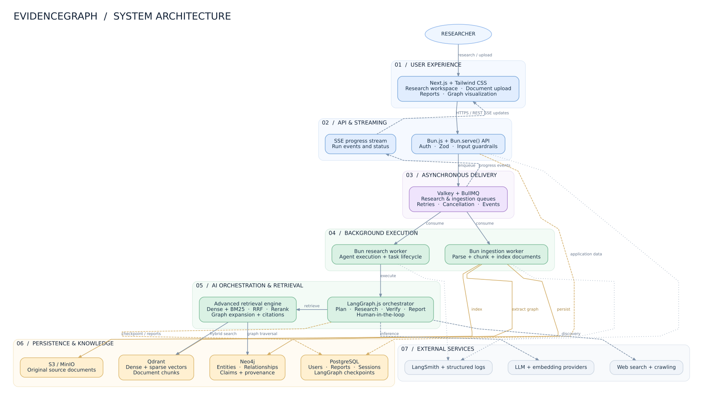

<div align="center">

# EvidenceGraph

### Research that shows its work.

Ask a question. Search your documents and the web. Review evidence, verify claims, and read a cited report — with each source one click away.

[](https://bun.sh)
[](https://developer.mozilla.org/en-US/docs/Web/JavaScript)
[](https://nextjs.org)
[](https://www.postgresql.org)
[](https://langchain-ai.github.io/langgraphjs/)
[](https://modelcontextprotocol.io)

**Bun · BullMQ · Valkey · PostgreSQL · Qdrant · Neo4j · MinIO · LangGraph · Better Auth · Next.js**

</div>

---

## What it does

- **Research workflows** — plan, gather evidence, evaluate coverage, verify claims, and compose reports with LangGraph.
- **Hybrid retrieval** — dense semantic vectors and sparse term search, fused with Reciprocal Rank Fusion and reranking.
- **Your documents** — upload PDF, text, or Markdown; extract, chunk, embed, and index with visible ingestion progress.
- **External search** — call web-search tools through MCP over stdio or Streamable HTTP. Retrieved content is treated as untrusted evidence.
- **Review and resume** — pause at a checkpoint for plan approval, then continue the same research thread.
- **Workspace isolation** — Better Auth sessions establish identity; workspace membership is validated server-side.
- **Traceable reports** — citations navigate to their sources; revisions and execution events are persisted.

## Architecture

The system architecture is shown below; the SVG is rendered directly from the repository so it stays versioned with the implementation.

<div align="center">
  
  <br />
  <sub>High-level system architecture · <a href="./01_system_architecture.svg">open diagram</a></sub>
</div>

<details>
  <summary>More architecture diagrams</summary>
  <ul>
    <li><a href="./02_langgraph_agent_architecture.svg">LangGraph agent architecture</a></li>
    <li><a href="./03_advanced_rag_architecture.svg">Advanced RAG architecture</a></li>
  </ul>
</details>

| Service                | Technology                  | Responsibility                                             |
| ---------------------- | --------------------------- | ---------------------------------------------------------- |
| Web                    | Next.js + Tailwind          | Sign-in, workspace, live progress, documents, reports      |
| API                    | Bun `Bun.serve()` + Fetch   | Auth, validation, task/document routes, SSE, readiness     |
| Workers                | Bun + BullMQ                | Research graph execution and document ingestion            |
| Queue / events         | Valkey + BullMQ             | Dispatch, retries, cancellation markers, event streams     |
| Metadata / checkpoints | PostgreSQL + Drizzle        | Users, workspaces, tasks, chunks, reports, LangGraph state |
| Vector search          | Qdrant                      | Dense and sparse chunk vectors with tenant filters         |
| Knowledge graph        | Neo4j                       | Documents, entities, claims, relationships                 |
| Object storage         | MinIO (S3 API)              | Uploaded document bytes                                    |
| Authentication         | Better Auth                 | Accounts, sessions, workspace identity                     |
| AI integrations        | LangChain + LangGraph + MCP | Model adapters, tool use, retrieval, verification          |

See the architecture diagrams: [`01_system_architecture.svg`](./01_system_architecture.svg), [`02_langgraph_agent_architecture.svg`](./02_langgraph_agent_architecture.svg), and [`03_advanced_rag_architecture.svg`](./03_advanced_rag_architecture.svg).

## Quick start

### Requirements

- [Bun](https://bun.sh) 1.4.3+
- Docker with Compose ([OrbStack](https://orbstack.dev) is used for local development on macOS)

### Install and configure

```sh
cp .env.example .env
bun install
```

`.env.example` contains local infrastructure settings and provider placeholders. Never commit `.env` or expose provider keys to the browser.

### Start infrastructure

```sh
docker compose up -d
docker compose ps
bun run db:migrate
```

The default Compose profile starts infrastructure only. This avoids duplicate queue consumers when host workers are started in the next step. Containerized workers are optional:

```sh
docker compose --profile workers up -d
```

### Start the application

Open three terminals from the repository root:

```sh
# Terminal 1 — API, http://localhost:3000
NODE_ENV=development bun run dev:api
```

```sh
# Terminal 2 — host workers
bun run dev:workers:research
bun run dev:workers:documents
```

```sh
# Terminal 3 — web app, http://localhost:3001
API_ORIGIN=http://localhost:3000 bun --cwd apps/web dev
```

Open <http://localhost:3001>, create an account, and start a research run.

### Local service ports

Host ports are remapped to avoid conflicts with other projects on the machine.

| Service           | Host                      | Container       |
| ----------------- | ------------------------- | --------------- |
| Valkey            | `localhost:6380`          | `6379`          |
| MinIO API         | `localhost:9000`          | `9000`          |
| PostgreSQL        | `localhost:5433`          | `5432`          |
| Qdrant            | `localhost:6335` / `6336` | `6333` / `6334` |
| Neo4j HTTP / Bolt | `localhost:7475` / `7688` | `7474` / `7687` |
| API               | `localhost:3000`          | —               |
| Web               | `localhost:3001`          | —               |

## Configure real providers

All provider settings are read from `.env` and validated centrally. The required LLM values are:

```dotenv
LLM_BASE_URL=https://your-openai-compatible-gateway/v1
LLM_MODEL_NAME=your-chat-model
LLM_API_KEY=your-api-key
AI_INTEGRATIONS_ENABLED=true
```

Optional integrations:

```dotenv
# Embeddings; falls back to LLM_BASE_URL and LLM_API_KEY if omitted.
EMBEDDING_BASE_URL=https://your-embedding-gateway/v1
EMBEDDING_MODEL_NAME=your-embedding-model
EMBEDDING_API_KEY=your-embedding-key
EMBEDDING_DIMENSIONS=1024

# Reranking; without this, retrieval uses a deterministic lexical fallback.
RERANK_ENDPOINT=https://your-rerank-service/v2/rerank
RERANK_MODEL_NAME=your-rerank-model
RERANK_API_KEY=your-rerank-key

# MCP search over stdio, for example Firecrawl MCP.
MCP_SEARCH_TRANSPORT=stdio
MCP_SEARCH_COMMAND=npx
MCP_SEARCH_ARGS=["-y","firecrawl-mcp"]
MCP_SEARCH_TOOL=firecrawl_search
MCP_SEARCH_TOKEN=your-search-token
MCP_SEARCH_TOKEN_ENV=FIRECRAWL_API_KEY

# Or use a remote Streamable HTTP MCP endpoint.
# MCP_SEARCH_TRANSPORT=http
# MCP_SEARCH_URL=https://your-mcp-server.example/mcp
# MCP_SEARCH_TOKEN=your-mcp-bearer-token
```

**No fabricated provider output:** automated tests use local MCP fixtures and mocked model clients. If production web search is not configured, the system returns `WEB_SEARCH_UNAVAILABLE`; it does not substitute fake results. Free-tier providers may impose their own model access, credit, or rate limits.

## Authentication

Local defaults are in `.env.example`. Production must set a real `AUTH_SECRET` (32+ characters) and `AUTH_URL`; startup fails closed when either is missing.

The browser uses the Next.js same-origin proxy for `/api/auth/*` and `/api/v1/*`. The API derives identity from the Better Auth session cookie. `x-workspace-id` selects scope only after membership validation; it cannot establish identity or grant workspace access.

## Development checks

```sh
bun test
bun run lint
bun run format:check
bun --cwd apps/web build
bun run db:generate
```

Local quality checks are intentional; this repository does not configure GitHub Actions.

### Real-service suites

These require `docker compose up -d`:

```sh
bun run test:phase2:integration   # Valkey, BullMQ, MinIO
bun run test:phase3:integration   # workers, cancellation, timeout, recovery
bun run test:phase4:integration   # PostgreSQL, Qdrant, Neo4j, MinIO
bun run test:phase6:integration   # LangGraph checkpoints + storage integration
bun run test:phase7:integration   # Better Auth + PostgreSQL
```

HTTP end-to-end smoke requires the API and web server on ports 3000 and 3001:

```sh
bun run test:phase7:e2e
```

Release checks migrations against an empty temporary schema and confirms existing database, Valkey, and MinIO data survives:

```sh
bun run verify:release
```

## Troubleshooting

- **`403 INVALID_ORIGIN`** — restart the API after changing `.env`; add any non-local web origin to `AUTH_TRUSTED_ORIGINS`. Development automatically trusts `localhost:3001` and `127.0.0.1:3001`.
- **Research is synthetic** — check that the research worker started with `.env` and logs `Research integrations initialized`. Stop optional Compose worker containers if they are competing with host workers: `docker compose stop research-worker document-worker`.
- **`WEB_SEARCH_UNAVAILABLE`** — configure `MCP_SEARCH_TRANSPORT` and its command or URL.
- **`429 RATE_LIMITED`** — the API applies a per-workspace request limit; a polling loop can exhaust it. The workspace refresh interval is throttled, and the limit can be configured in `createApiHandler`.
- **Embedding/rerank provider errors** — the ingestion panel and worker logs show the classified provider error. Check model access, vector dimensions, provider credits, and rate limits.
- **Docker ports already in use** — use the remapped host ports above. Do not stop the unrelated `ash-agent` containers that own the default ports.
- **Qdrant API mismatch** — the JS client is pinned to `1.13.0` to match the `v1.13.4` server.

## Repository layout

```text
apps/
  api/       Bun HTTP API and route tests
  workers/   research and document worker processes
  web/       Next.js research workspace
packages/
  ai/        MCP, LLM adapters, LangGraph workflow
  auth/      Better Auth and workspace identity
  config/    centralized Zod environment validation
  persistence/ PostgreSQL, migrations, Neo4j graph repository
  queue/     BullMQ, Valkey, task and event coordination
  retrieval/ Qdrant vectors and hybrid search
  shared/    errors and terminal logging
  object-storage/ MinIO S3 adapter
```

## License

No license file is currently included. Add one before distributing this repository under an open-source license.
