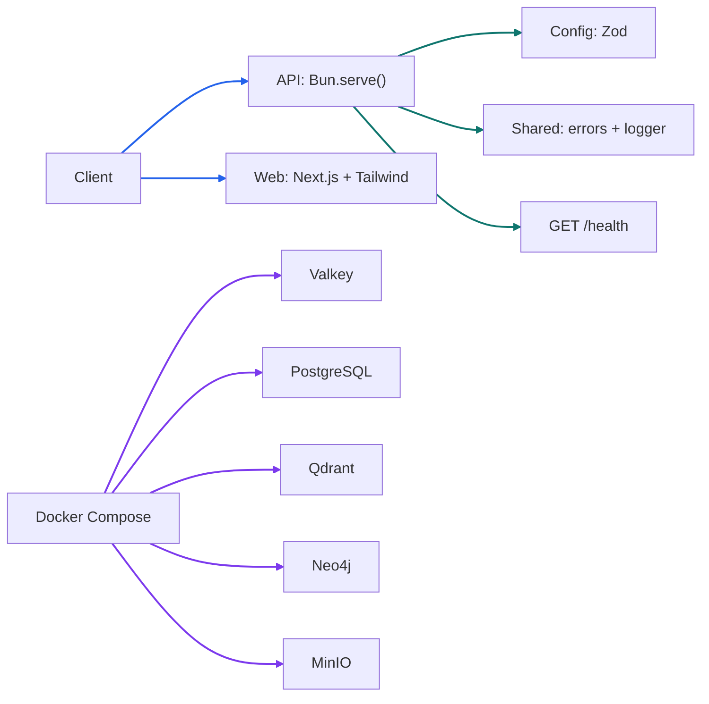

# Phase 0 Tutorial: Project Initialization

## 1. Phase Overview

Phase 0 creates the foundation for EvidenceGraph: a Bun workspace, shared configuration and utilities, a minimal API health endpoint, local infrastructure definitions, and repeatable quality checks. The purpose is to make later phases add capabilities to clear package boundaries rather than starting with an unstructured application.

This phase does **not** implement research workflows, document ingestion, database repositories, queues, or LLM calls. Those belong to later roadmap phases. The LLM configuration interface is prepared now, but an LLM provider is not called.

## 2. Learning Objectives

After this phase, you should be able to:

- Explain how Bun workspaces organize multiple packages in one repository.
- Load and validate environment variables centrally with Zod.
- Keep secrets out of version control and logs.
- Start a Bun `Bun.serve()` API and test a health route without opening a network port.
- Define repeatable local developer checks with ESLint, Prettier, Bun tests, and a production frontend build.
- Run local development dependencies through Docker Compose and named volumes.

## 3. Prerequisites

You need Bun (the project was initialized with Bun 1.4.3), Docker with the Compose plugin for local infrastructure, and Git. A code editor and a terminal are also required.

From the repository root, copy `.env.example` to `.env` if you want to override the documented local development settings. `.env` is ignored by Git. The LLM variables in the example are placeholders; configure real provider values only in your local `.env` when a later LLM integration needs them. Never commit or paste real credentials into source code, tests, documentation, or logs.

Install workspace dependencies with:

```sh
bun install
```

## 4. Architecture Explanation

The root `package.json` owns scripts and discovers every directory under `apps/*` and `packages/*` as workspace packages. `apps/api` contains an API process served directly by Bun's native `Bun.serve()` API; `apps/web` is an initialized Next.js App Router application styled with Tailwind CSS. `packages/config` owns validated configuration, and `packages/shared` contains reusable errors and logging. The remaining package manifests reserve boundaries used by subsequent phases; they do not pretend their features are implemented yet.



The API's health endpoint currently reports that the HTTP process is alive. It does not yet claim that databases or other services are reachable; connectivity checks will be implemented with their clients in later phases.

## 5. Step-by-Step Implementation

### 5.1 Workspace and package boundaries

The root workspace globs are `apps/*` and `packages/*`. Applications are deployable processes; packages hold reusable functionality. This is a small monorepo structure that lets API, worker, and frontend work proceed independently while sharing validated configuration and utilities.

Phase 0 initializes `apps/api` and `apps/web`, and provides manifests for `apps/workers` and the planned AI, retrieval, persistence, and integrations packages. The web app is a minimal Next.js App Router shell with Tailwind CSS and no research features yet. The workers and domain package manifests only document future boundaries; their behavior is deferred to later phases.

### 5.2 Frontend application shell

`apps/web` contains a minimal Next.js App Router application. `app/layout.js` supplies the root HTML document and page metadata, while `app/page.js` renders a simple placeholder workspace. The PostCSS plugin loads Tailwind CSS v4 through `app/globals.css`. The page intentionally has no API calls, authentication, or research controls; those are later-phase work. Keeping this shell minimal verifies the selected frontend stack and leaves the user experience to Phase 7.

### 5.3 Centralized configuration and secrets

`packages/config/src/index.js` exports two functions:

- `getRuntimeConfig()` validates general process settings and supplies safe defaults for `NODE_ENV` and `PORT`.
- `getLlmConfig()` validates `LLM_BASE_URL`, `LLM_MODEL_NAME`, and `LLM_API_KEY` and returns one consistent object (`baseUrl`, `modelName`, `apiKey`).

Keeping these accessors separate means the API can start before an LLM provider is configured, while any future component that requests LLM settings must receive all three validated values. The error identifies missing variable names and points to `.env.example`; it never includes the supplied key value. Do not log the returned configuration object because it contains a secret.

Bun automatically loads a root `.env` file into the process environment. `.env.example` is a template; `.gitignore` excludes `.env` and local environment variants while allowing `.env.example` to be checked in.

### 5.4 Shared utilities and API health route

`packages/shared/src/index.js` defines `AppError`, which carries a stable error code and optional cause, and a small JSON logger. Structured logs make fields machine-readable, but callers must not pass secrets as fields.

`apps/api/src/index.js` reads runtime configuration, creates the Fetch-compatible handler with `createApiHandler()`, and passes it directly to `Bun.serve()`. `apps/api/src/app.js` dispatches standard `Request` objects and returns standard `Response` objects. The public health route returns `{ "data": { "status": "ok" } }`; Phase 1 also adds versioned task/document routes, validation, security contracts, and streaming.

The route test calls `handleRequest()` with standard `Request` objects. This verifies route behavior without starting a server or relying on a free TCP port.

### 5.5 Local infrastructure

`docker-compose.yml` defines Valkey, PostgreSQL, Qdrant, Neo4j, and MinIO with named volumes and health checks. Named volumes preserve development data when containers are recreated. Compose interpolation supports local defaults, and `.env.example` shows the matching variables.

Start the infrastructure with:

```sh
docker compose up -d
```

Inspect service status and health with:

```sh
docker compose ps
```

Stop containers while preserving named-volume data with:

```sh
docker compose down
```

This Compose file is for local infrastructure only. `Dockerfile` is the separate application image definition for the minimal API. No container-to-container database integration is implemented in this phase.

### 5.6 Local quality checks

Root scripts provide test, lint, and formatting checks. Public JavaScript helpers use JSDoc parameter and return annotations, including inferred types from Zod schemas, so editors can provide useful type feedback without changing the project to TypeScript. Run the frontend production build locally with `bun --cwd apps/web build`. The lockfile makes dependency resolution repeatable. No GitHub Actions workflow is configured.

## 6. Code Walkthrough

| File                                | Purpose                                                                    |
| ----------------------------------- | -------------------------------------------------------------------------- |
| `package.json`                      | Workspace declaration, root scripts, shared development tools.             |
| `bun.lock`                          | Locked dependency versions generated by `bun install`.                     |
| `apps/api/package.json`             | API package dependencies and run scripts.                                  |
| `apps/api/src/index.js`             | Serves `GET /health` through Bun's native `Bun.serve()` API.               |
| `apps/web/app/page.js`              | Minimal placeholder page for the Next.js App Router application.           |
| `apps/web/app/layout.js`            | Root document structure and metadata for the frontend.                     |
| `apps/web/app/globals.css`          | Tailwind CSS v4 import and minimal global defaults.                        |
| `apps/web/postcss.config.mjs`       | Enables the Tailwind CSS PostCSS plugin.                                   |
| `apps/web/next.config.mjs`          | Next.js configuration entry point.                                         |
| `apps/api/src/index.test.js`        | Tests health response in process.                                          |
| `packages/config/src/index.js`      | Zod schemas and centralized runtime/LLM configuration accessors.           |
| `packages/config/src/index.test.js` | Tests defaults, coercion, invalid input, and missing LLM settings.         |
| `packages/shared/src/index.js`      | Shared error type and structured logger.                                   |
| `packages/shared/src/index.test.js` | Tests error metadata and causes.                                           |
| `.env.example`                      | Safe placeholder template for local configuration.                         |
| `.gitignore`                        | Excludes `.env` secrets and preserves existing repository ignore rules.    |
| `docker-compose.yml`                | Local infrastructure services, named volumes, and health checks.           |
| `Dockerfile`                        | Separate API application image definition.                                 |
| `.dockerignore`                     | Excludes local dependencies, build output, and secrets from image context. |

## 7. Testing and Verification

Run the checks from the repository root:

```sh
bun test
bun run lint
bun run format:check
bun --cwd apps/web build
```

Run the API locally:

```sh
bun run dev:api
```

Run the frontend in another terminal:

```sh
bun --cwd apps/web dev
```

In another terminal, request the health response:

```sh
curl http://localhost:3000/health
```

Expected response:

```json
{ "data": { "status": "ok" } }
```

The configuration tests exercise environment objects directly, avoiding reliance on a developer's actual `.env`. They verify runtime defaults, port conversion, invalid ports, the successful LLM settings mapping, and missing-variable errors. The frontend build verifies that Next.js can compile and statically render the initial page. Compose health checks can be inspected with `docker compose ps` once Docker is running.

## 8. Common Issues

- **`bun: command not found`:** Install Bun and ensure its executable directory is on `PATH`; reopen the terminal after changing shell configuration.
- **Workspace package cannot be resolved:** Run `bun install` from the repository root, and check that the dependency is declared with the correct workspace name.
- **Port 3000 is already in use:** Set `PORT` in your ignored local `.env` to a free port, then restart the API.
- **LLM configuration throws:** This is expected if code calls `getLlmConfig()` without all three valid `LLM_*` values. Add local values to `.env`; do not weaken validation or place credentials in code.
- **Docker commands cannot connect:** Start Docker Desktop/OrbStack (or the configured Docker daemon), then retry `docker compose up -d`.
- **A service is unhealthy:** Use `docker compose logs <service>` and `docker compose ps` to inspect startup and health-check output. Preserve volumes unless you intentionally want to remove local data.
- **Formatting checks fail:** Run `bun run format` on the changed files and inspect the diff before committing.

## 9. Interview Preparation

### Why use a monorepo workspace instead of one large application directory?

A workspace lets independently deployable apps and shared packages use one lockfile and common tooling. Explicit package boundaries reduce accidental coupling. The trade-off is added workspace configuration and the need to keep dependency direction intentional.

### Why validate environment variables with Zod?

Environment values arrive as untyped strings and may be missing or malformed. Zod validates them at a boundary and provides structured issues. Central validation avoids inconsistent assumptions across services. Secrets should be validated but never included in error messages or logs.

### Why is LLM configuration accessed separately from runtime configuration?

The API and local infrastructure can run before any model integration exists. `getLlmConfig()` makes LLM settings mandatory at the point a model-enabled feature requests them, while keeping unrelated processes usable. When Phase 5 adds LLM integrations, each must use this shared accessor rather than embedding provider configuration.

### What does the `/health` route prove, and what does it not prove?

It proves the API process can respond to an HTTP request. It does not prove PostgreSQL, Qdrant, Neo4j, Valkey, or object storage are reachable. Dependency-aware readiness checks should be added when those clients and service lifecycle requirements are implemented.

### Why use named Docker volumes for local services?

Named volumes keep service data outside a container's writable layer, so recreating a container does not automatically erase local data. The trade-off is that stale development data can survive configuration changes; developers should deliberately manage volumes rather than deleting them blindly.

### How would you explain this phase in an interview?

“I established a Bun workspace with clear app/package boundaries, initialized a Next.js and Tailwind frontend shell, centralized Zod-validated environment configuration, shared error/logging utilities, a native `Bun.serve()` health endpoint, and Compose definitions for local infrastructure. The same lint, formatting, and tests can be run locally from the repository root. I kept research and integration behavior out of the scaffold, and the health route reports process health only—not dependency readiness.”

## 10. Phase Summary

Phase 0 establishes the root-level Bun monorepo and its development foundation. It provides centralized configuration (including a safe, validated interface for future LLM settings), shared utilities, a minimal API health route, local infrastructure definitions, tests, quality checks, and this tutorial. The next phase is Phase 1: API contracts, validation, security boundaries, research/document endpoints, and SSE. Phase 0 is complete only when the checks documented above pass and local infrastructure health is verified in an available Docker environment.
