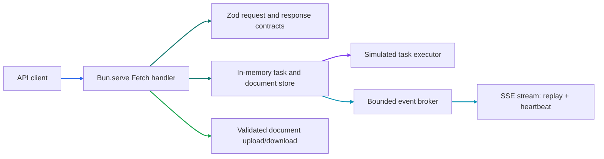

# Phase 1 Tutorial: API and Streaming

## 1. Phase Overview

Phase 1 turns the minimal Bun server into a versioned API for research tasks and documents. It validates requests and responses with Zod, applies consistent response envelopes and basic request protections, simulates task execution in memory, and streams task events over Server-Sent Events (SSE).

The word **simulated** matters: research results are placeholders, uploaded documents and tasks live only in process memory, and no real queue, worker, database, document parser, or LLM is connected yet. Those integrations belong to later roadmap phases.

This tutorial records the Phase 1 baseline. Phase 2 preserves these HTTP and event contracts but replaces the default runtime store with BullMQ, Valkey, and MinIO; `memory-store.js` remains the fast test adapter. Production worker execution remains deferred to Phase 3.

## 2. Learning Objectives

After this phase, you should be able to:

- Build an HTTP API directly with Bun's `Bun.serve()` and standard `Request`/`Response` APIs.
- Validate untrusted input and generated output with Zod schemas.
- Design versioned REST routes, success/error envelopes, and appropriate HTTP status codes.
- Model an asynchronous task lifecycle and expose status, result, cancellation, and retry behavior.
- Stream typed SSE events, replay events with `Last-Event-ID`, and clean up closed connections.
- Apply payload limits, MIME/filename checks, ownership scoping, rate limits, and safe logging.
- Explain the limitations of in-memory state and a development-only identity provider.

## 3. Prerequisites

You need Bun 1.4.3 or a compatible later version, Git, and the Phase 0 workspace installed. Docker is not required for this phase because these endpoints do not yet connect to the Compose services. From the repository root, run:

```sh
bun install
```

For local API development, use a non-production `NODE_ENV` (the default runtime configuration is development). Protected routes intentionally refuse to run in production until a real authentication provider is integrated.

## 4. Architecture Explanation

`apps/api/src/index.js` starts the service with `Bun.serve({ port, fetch: handleRequest })`. The Fetch handler in `app.js` owns routing, authentication context, request limits, response envelopes, and logging. Zod contracts live in `contracts.js`; `memory-store.js` implements task/document ownership and simulated lifecycle state; `event-broker.js` validates, retains, replays, and streams task events.



The API has three response forms. JSON success responses use `{ "data": ... }`; JSON errors use `{ "error": { "code": ..., "message": ... } }`; SSE and document downloads use their transport-specific formats. `/health` is public and returns the same success envelope as other JSON endpoints. Protected routes use an injected identity contract. The default identity is a fixed local development identity and returns `503 AUTH_NOT_CONFIGURED` in production; it is not real authentication.

## 5. Step-by-Step Implementation

### 5.1 Define request and response contracts

`contracts.js` contains strict Zod object schemas. `.strict()` rejects unknown properties instead of silently accepting misspelled or unsupported fields. `createResearchTaskSchema` trims and bounds the question, then parses a nested config with defaults:

- `depth`: `quick`, `standard`, or `deep`.
- `maxSources`: integer from 1 to 50.
- `maxIterations`: integer from 1 to 10.
- `maxDurationSeconds`: integer from 10 to 300.

These fields define the future execution contract; the Phase 1 simulator does not enforce a real time or model budget. A later worker phase must enforce them during actual execution.

The API parses request bodies before calling the store and validates returned data before sending it. This catches invalid data at both boundaries. Errors from Zod are converted to `400 VALIDATION_ERROR` with issue details, without echoing the submitted body.

### 5.2 Use a consistent error boundary and response envelope

`createApiHandler()` wraps dispatch in one `try/catch`. Known `ApiError` instances keep their status, code, message, and optional details. Unexpected errors are logged without request bodies or secrets and returned as a generic `500 INTERNAL_ERROR`.

The `jsonResponse()` helper validates response data and wraps it as `{ data }`. Error responses are validated against their own schema. HTTP status codes communicate the outcome: `201` for a stored document, `202` for an accepted research task, `400` for invalid input, `404` for missing or non-owned records, `409` for invalid lifecycle transitions, `413` for oversized payloads, `415` for unsupported media, and `429` for throttling.

### 5.3 Submit and simulate research tasks

Create a task with `POST /api/v1/research-tasks`:

```sh
curl -X POST http://localhost:3000/api/v1/research-tasks \
  -H 'Content-Type: application/json' \
  -d '{"question":"How do urban trees affect summer temperatures?","config":{"depth":"standard","maxSources":8}}'
```

The response is `202` with a task ID and the parsed configuration. `memory-store.js` records the task with `queued` status, emits creation/queue events, and schedules the simulator. The default simulator advances through `processing` and a progress event before returning an explicitly synthetic result. The synthetic marker prevents a placeholder from being confused with evidence-backed research.

The remaining task routes are:

| Method | Route                               | Behavior                                                       |
| ------ | ----------------------------------- | -------------------------------------------------------------- |
| `GET`  | `/api/v1/research-tasks`            | List this identity's task history.                             |
| `GET`  | `/api/v1/research-tasks/:id`        | Retrieve a task.                                               |
| `GET`  | `/api/v1/research-tasks/:id/status` | Retrieve lifecycle status.                                     |
| `GET`  | `/api/v1/research-tasks/:id/result` | Retrieve a completed result; otherwise return `409`.           |
| `POST` | `/api/v1/research-tasks/:id/cancel` | Cancel queued or processing work; terminal tasks return `409`. |
| `POST` | `/api/v1/research-tasks/:id/retry`  | Create a new linked task only when the original failed.        |
| `GET`  | `/api/v1/research-tasks/:id/events` | Subscribe to task events as SSE.                               |

Retries create a new task and keep the original record; `retryOf` links the new task to its predecessor. The default simulator normally completes, so tests inject a failing executor to verify retry behavior without adding a public “force failure” switch.

### 5.4 Upload, retrieve, and delete documents

Upload one file as multipart form data to `POST /api/v1/documents`:

```sh
curl -X POST http://localhost:3000/api/v1/documents \
  -F 'file=@./notes.txt;type=text/plain'
```

Only `.pdf`, `.txt`, and `.md` files with matching supported media types are accepted. Filenames are reduced to a safe basename and sanitized before being returned or placed in `Content-Disposition`. Empty files are rejected. The file limit is 5 MiB; the multipart request has an additional bounded allowance for its encoding overhead.

The document routes provide listing (`GET /api/v1/documents`), metadata (`GET /api/v1/documents/:id`), status (`GET /api/v1/documents/:id/status`), content download (`GET /api/v1/documents/:id/content`), and deletion (`DELETE /api/v1/documents/:id`). Downloads are scoped to the same identity as the metadata routes and include `X-Content-Type-Options: nosniff`.

The in-memory store caps the total uploaded bytes at 25,000,000 and the number of records at 1,000. Status is only `uploaded`; parsing, indexing, and ingestion status transitions are not implemented in Phase 1.

### 5.5 Stream validated events with SSE

Subscribe after creating a task:

```sh
curl -N http://localhost:3000/api/v1/research-tasks/TASK_ID/events
```

The server emits a connection comment, then events with `id`, `event`, and JSON `data` fields. Event types are `task.created`, `task.queued`, `task.processing`, `research.progress`, `task.completed`, `task.failed`, and `task.cancelled`. Each type has its own Zod-validated data shape. Terminal events close the stream.

The client can reconnect with the last event ID it processed:

```sh
curl -N -H 'Last-Event-ID: 2' \
  http://localhost:3000/api/v1/research-tasks/TASK_ID/events
```

The broker retains the latest 100 events per task. If the requested cursor predates retained history, it emits `stream.reset` with the oldest available event ID, then sends the retained events. A 15-second heartbeat keeps idle connections active. Subscriber counts are capped at 32 per task; cancellation, abort signals, terminal events, and backpressure close the subscription and clear its heartbeat timer.

SSE is a one-way server-to-client stream. The client still submits commands and requests snapshots using ordinary HTTP routes. This separation keeps mutations and reconnectable progress delivery simple.

### 5.6 Apply security boundaries and resource limits

All protected routes call the authentication contract before accessing records. The default implementation provides a fixed local identity outside production and refuses protected requests in production. A future auth provider can be injected without trusting client-supplied `userId` or `workspaceId` headers. The store checks both user and workspace ownership; records belonging to another identity return `404`, avoiding disclosure that an identifier exists.

Other Phase 1 limits are:

- JSON request body: 1 MiB.
- Uploaded file: 5 MiB; multipart body: file limit plus 64 KiB overhead.
- In-memory tasks and documents: at most 1,000 records of each type.
- Total in-memory document content: 25,000,000 bytes.
- Requests: 120 per identity per 60-second window; `/health` is exempt.
- SSE history and subscribers: 100 events and 32 subscribers per task.

The rate limiter and ownership records are process-local and reset on restart. They are suitable for development contracts, not distributed production protection. The API logger records method, path, status, and duration only—not request content, authorization data, or uploaded bytes.

## 6. Code Walkthrough

| File                           | Responsibility                                                                                            |
| ------------------------------ | --------------------------------------------------------------------------------------------------------- |
| `apps/api/src/index.js`        | Reads the runtime port and starts `Bun.serve()` with the Fetch handler.                                   |
| `apps/api/src/app.js`          | Routes, auth contract, body limits, upload checks, response envelopes, rate limits, and request logs.     |
| `apps/api/src/contracts.js`    | Zod schemas for task inputs, task/result/document responses, envelopes, and discriminated event payloads. |
| `apps/api/src/memory-store.js` | Owner-scoped task/document maps, task state transitions, synthetic execution, retries, and storage caps.  |
| `apps/api/src/event-broker.js` | Event schema validation, bounded history, replay, subscriber management, heartbeats, and SSE framing.     |
| `apps/api/src/index.test.js`   | End-to-end handler tests for HTTP behavior, limits, identity, lifecycle, documents, and SSE.              |
| `packages/shared/src/index.js` | Structured logger used for request and unexpected-error logging.                                          |

The tests call the exported handler with standard `Request` objects, so they do not need to reserve a TCP port. The scheduler and executor are injectable into the in-memory store; this makes time-dependent transitions and failures deterministic in tests.

## 7. Testing and Verification

From the repository root, run:

```sh
bun test
bun run lint
bun run format:check
bun --cwd apps/web build
```

Start the API with:

```sh
bun run dev:api
```

Check the public health endpoint:

```sh
curl http://localhost:3000/health
```

Expected JSON shape:

```json
{ "data": { "status": "ok" } }
```

Then submit a research task using the example above, copy its returned `data.id`, and use that ID in the status, result, and SSE routes. To verify file handling, upload a small text file and then request its `content` route. The integration tests also exercise malformed JSON, invalid configuration, oversized JSON and uploads, unsupported file types, ownership isolation, rate limits, cancellation, retry, event replay, replay gaps, and stream cleanup.

## 8. Common Issues

- **`503 AUTH_NOT_CONFIGURED`:** Protected routes are disabled when `NODE_ENV=production` until a real authentication provider is wired. Use a local development environment for this phase; do not replace the guard with a production-wide anonymous identity.
- **`409 RESULT_NOT_AVAILABLE`:** A task has not completed, or ended without a result. Poll its status or follow its SSE events before requesting a result.
- **`409 TASK_NOT_RETRYABLE`:** Retry is allowed only for failed tasks. Cancellation is not failure and is not retryable under the current contract.
- **`413 PAYLOAD_TOO_LARGE` / `FILE_TOO_LARGE`:** Keep JSON below 1 MiB and each supported file at or below 5 MiB.
- **`415 UNSUPPORTED_FILE_TYPE`:** Use a supported file extension and matching content type (`application/pdf`, `text/plain`, or a supported Markdown type).
- **`429 RATE_LIMITED`:** Requests exceeded the per-identity in-memory window. Honor `retryAfterSeconds` from error details.
- **SSE returns `stream.reset`:** The requested event ID is older than the 100 events retained for that task. Refresh task status and continue from the newly received IDs.
- **Tasks/documents disappear after restart:** This is expected: process memory is intentionally temporary. Persistence and object storage arrive later.
- **No real findings appear in the result:** Phase 1 returns a result marked `synthetic: true`; real retrieval and model execution are later phases.

## 9. Interview Preparation

### Why use both request and response validation?

Request validation protects internal code from malformed external values. Response validation catches bugs in the data produced by the application before an invalid contract reaches clients. Applying schemas at both boundaries makes API behavior explicit and testable.

### Why return `202 Accepted` for task creation?

The request creates work that continues after the HTTP response. `202` communicates that the server accepted the request but the final result is not ready. Clients then inspect status or subscribe to events rather than holding the submission request open.

### How does SSE reconnection work here?

Every event has a per-task numeric ID. The client sends its last processed ID in `Last-Event-ID`; the server replays newer retained events. If the cursor predates bounded history, `stream.reset` signals that the client should refresh a state snapshot. This gives at-least-once-style replay within the process's retained window, not durable delivery across restarts.

### What is the purpose of a bounded event history and subscriber limit?

Without bounds, disconnected clients and event production could grow memory usage indefinitely. Retaining only 100 events per task and allowing at most 32 subscribers per task creates predictable process-local limits. Production multi-instance delivery later needs a shared broker and durable state.

### Is the default local identity authentication?

No. It is a development-only identity contract so ownership rules can be exercised before an auth provider exists. Protected production requests fail closed. A real provider must authenticate credentials, derive trusted user/workspace IDs, and supply that context to the handler; client-supplied ownership headers are not trusted.

### Why return `404` for another user's task instead of `403`?

A `404` response avoids confirming that a record exists outside the caller's scope. The store applies the same owner check to reads, cancellation, retry, and document operations.

### Why keep this store in memory instead of connecting the database now?

The roadmap separates API contracts from persistence, queues, and worker execution. In-memory state makes the contract and lifecycle testable without pretending a production repository exists. The trade-off—loss on restart and process-local coordination—is explicit and is replaced in later phases.

### How would you describe the completed work in an interview?

“I built a versioned API directly on Bun's Fetch handler, defined strict Zod contracts and standard envelopes, and modeled asynchronous research requests with a testable in-memory executor. I added owner-scoped document APIs with bounded uploads, replayable typed SSE, request throttling, and lifecycle/error tests. I kept authentication explicitly development-only and fail-closed in production, and marked results synthetic so the API contract can be validated before queues, persistence, retrieval, or LLM execution are integrated.”

## 10. Phase Summary

Phase 1 delivers versioned research-task and document routes, validated request/response contracts, consistent JSON envelopes, simulated task lifecycle and retry/cancellation behavior, bounded document uploads, identity/ownership boundaries, rate limiting, structured request logs, and replayable SSE with cleanup. All state and rate limits are process-local, results are synthetic, and the default identity is not production authentication.

**Next-phase dependencies:** Phase 2 replaces scheduled in-process task simulation with durable queue submission and lifecycle operations. Later persistence and worker phases must preserve these HTTP contracts while replacing the in-memory store, and a real auth provider must replace the development identity before protected production use.
