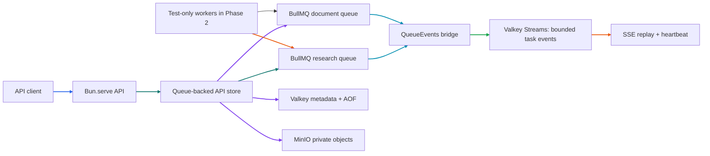

# Phase 2 Tutorial: Asynchronous Delivery

## 1. Phase Overview

Phase 2 replaces Phase 1's in-process task simulator with durable BullMQ queues backed by authenticated Valkey. It creates separate research and document-ingestion queues, stores document bytes in MinIO, keeps transitional task/document metadata in Valkey, and forwards validated queue events into replayable SSE streams.

This phase builds **delivery**, not production execution. The API enqueues jobs, but no production worker process consumes them until Phase 3. Test-only workers in the integration suite prove the queue, progress, retry, cancellation, and object-reference contracts. Consequently, production tasks remain queued during Phase 2.

MinIO integration was intentionally advanced from Phase 4 because a future worker in a separate process must be able to retrieve file bytes. Phase 4 will add durable database metadata associations and processing policies rather than reimplementing the S3 client.

## 2. Learning Objectives

After this phase, you should be able to:

- Explain how BullMQ uses Valkey/Redis to store and coordinate jobs.
- Configure authenticated, retrying Valkey connections and persistent local development data.
- Define separate queues, validated job payloads, queue options, retry policy, and retention.
- Store document bytes in S3-compatible MinIO and pass only object references through jobs.
- Make API task/document operations idempotent with identity-scoped keys.
- Bridge BullMQ QueueEvents to a shared, bounded Redis Stream consumed by SSE clients.
- Distinguish queue-level automatic retries from the API's retry-as-a-new-task contract.
- Explain why production workers and active cancellation are deferred to Phase 3.

## 3. Prerequisites

You need Bun 1.4.3 or a compatible later release, Git, and Docker with the Compose plugin. Docker must be running for the real-service integration tests. Compose exposes Valkey on host port `6380` (container port `6379`) to avoid clashing with other local Valkey instances; MinIO uses ports `9000`/`9001`.

From the repository root, copy the safe template and install dependencies:

```sh
cp .env.example .env
bun install
```

The checked-in template contains local development credentials only. Replace them for any non-local deployment and keep `.env` untracked. In production, `VALKEY_URL`, `VALKEY_PASSWORD`, `MINIO_ENDPOINT`, `MINIO_ACCESS_KEY`, `MINIO_SECRET_KEY`, and `MINIO_BUCKET` must be explicitly configured; missing or invalid settings fail startup without printing secret values.

## 4. Architecture Explanation

The API validates a request, then calls the injected store. The production store writes task metadata to Valkey and enqueues a BullMQ job. For uploads, it writes the file to MinIO first and then queues a small job payload containing the object key. BullMQ QueueEvents listeners map queue changes into validated events and append them to a per-task Valkey Stream. Every API instance can replay and stream those shared events.



The test-only workers are not started by `apps/api/src/index.js`; they exist solely to validate worker-facing queue contracts. Phase 3 adds the real independently managed worker processes.

## 5. Step-by-Step Implementation

### 5.1 Configure authenticated Valkey and MinIO

`packages/config/src/index.js` owns the `getValkeyConfig()` and `getMinioConfig()` accessors. Local development defaults match `.env.example`. Production requires explicit environment values. Schema errors report variable names, not passwords or access keys.

The Compose Valkey service uses `--requirepass`, enables append-only file persistence, stores data in the named `valkey-data` volume, and authenticates its `PING` health check. It maps host port `6380` to the container's `6379` to avoid conflicts with other local Valkey instances. The API uses IORedis with a retry strategy that backs off to a 5-second maximum and a 15-second startup readiness deadline. `VALKEY_URL` uses `redis://` or `rediss://`; the password is passed separately rather than logged or embedded in diagnostic output.

Compose runs `cgr.dev/chainguard/minio:latest` with the existing server command, root credentials, ports, and `minio-data` named volume unchanged. The image entrypoint is `/usr/bin/minio`, it runs as UID `65532`, and it includes `mc` with the `local` alias used by `mc ready local`. The image's `/data` directory is writable by that non-root UID, including on a newly initialized named volume. The S3 client uses path-style requests and creates the configured private bucket on startup if it does not exist. A transient bucket-check failure can be retried rather than permanently caching a rejected initialization promise.

Start only the two Phase 2 services:

```sh
docker compose up -d valkey minio
docker compose ps
```

### 5.2 Define queue contracts and queue policies

`packages/queue/src/contracts.js` validates research and document-ingestion job payloads. Both include a server-derived owner context and a SHA-256 request fingerprint. The document payload includes a UUID document ID, safe filename, media type, byte size, and opaque object key; it never embeds document bytes.

`packages/queue/src/queues.js` creates two queues:

- `research` for research task requests.
- `document-ingestion` for document-processing requests.

Both queues use three automatic attempts with exponential backoff starting at one second. Completed and failed jobs are retained for up to 30 days, bounded by job counts. Test/worker concurrency defaults are exported separately (`research: 4`, `documentIngestion: 2`) for the Phase 3 worker package.

The API accepts optional queue controls on research submission:

```json
{
  "question": "How do urban trees affect summer temperatures?",
  "config": { "depth": "standard", "maxSources": 8 },
  "queueOptions": { "priority": 1, "delayMs": 0 }
}
```

`priority` is an integer from 0–10; 0 leaves the job unprioritized, and a lower positive value has higher priority. `delayMs` is bounded from 0 to 24 hours. Omitting `queueOptions` preserves Phase 1 client behavior.

### 5.3 Replace the in-memory research simulator at runtime

`apps/api/src/index.js` validates runtime, Valkey, and MinIO settings; initializes queues and the object-store bucket; and only then starts `Bun.serve()`. Startup failure closes connections and does not expose a partially initialized API. SIGINT/SIGTERM stop the server and close BullMQ, QueueEvents, IORedis, and S3 clients.

`createBullMqStore()` implements the same asynchronous store interface used by `createApiHandler()`. Production task metadata is stored in owner-scoped Valkey hashes and sorted-set indexes; BullMQ jobs carry the validated request and are the source for queue state and results. The in-memory adapter remains available for deterministic API unit tests.

`GET /health` remains a process-liveness check. `GET /ready` reports only dependency states, never connection strings or credentials:

```json
{
  "data": {
    "status": "ready",
    "dependencies": { "valkey": "ready", "minio": "ready" }
  }
}
```

If a dependency is unavailable, `/ready` returns `503` with that dependency marked `unavailable`; `/health` may still return `200` while the process is alive.

### 5.4 Add idempotency, job lifecycle, and cancellation limits

Research submissions and document uploads accept an optional `Idempotency-Key` header. The store scopes a hashed key to the authenticated user/workspace and resource type. Repeating the same key with the same payload returns the existing resource; reusing it with a different payload returns `409 IDEMPOTENCY_CONFLICT`. Keys remain effective for seven days, and concurrent requests using a currently locked key receive `409 IDEMPOTENCY_IN_PROGRESS`.

BullMQ states map to the Phase 1 task contract: waiting/delayed → `queued`, active → `processing`, completed → `completed`, and final failure → `failed`. BullMQ retries a failed attempt automatically before the job becomes terminal. The public `POST /research-tasks/:id/retry` contract still creates a **new linked task** (`retryOf`) after final failure.

The cancel route removes waiting/delayed work and writes a cancelled tombstone so history/status remain available. It does not claim that active computation stopped: an already-active job returns `409 ACTIVE_CANCELLATION_UNSUPPORTED`. Phase 3 adds worker checkpoints and cooperative cancellation.

### 5.5 Store document bytes in MinIO and queue references

The upload route keeps Phase 1's bounded multipart parsing and file checks, then performs these operations:

1. Generate a UUID and opaque object key (`documents/<uuid>`).
2. Upload the bytes and content type to the private MinIO bucket.
3. Save owner-scoped document metadata in Valkey.
4. Enqueue a `document-ingestion` job containing the object key and metadata only.

If queue/metadata creation fails after the object upload, the API attempts to delete the object as rollback. The `GET /documents/:id/content` route retrieves bytes from MinIO after verifying ownership. Deletion removes the queued job when safe, deletes the object, and removes metadata. Active document jobs cannot be deleted until a worker cancellation policy exists.

Document status is `queued`, `processing`, `completed`, or `failed` in the queue-backed adapter. No production document consumer exists in Phase 2, so new ingestion jobs normally remain `queued`; test-only integration workers verify that the object reference resolves to the uploaded bytes.

### 5.6 Bridge queue events to cross-instance SSE

BullMQ QueueEvents supplies a unique Redis Stream event ID as the listener's second argument. The adapter uses that ID for a Valkey deduplication key so multiple API instances do not publish duplicate lifecycle events. Early progress arriving while task creation is being finalized is buffered in Valkey and flushed after the initial `task.created`/`task.queued` events.

The shared event broker validates each event against the single queue-package `researchEventSchema`, uses a per-task sequence for the public numeric SSE `id`, and appends frames to a bounded Valkey Stream. The latest 100 events are replayable; the stream and sequence expire with 30-day task metadata. A stale `Last-Event-ID` yields a `stream.reset` event before the retained history. Each subscriber uses a dedicated blocking IORedis connection, a bounded subscriber counter, a 15-second heartbeat, and cleanup on terminal events, abort, or stream cancellation.

This makes replay shared across API instances, unlike the Phase 1 in-process event broker. It does not create production worker processes or make work survive a missing downstream worker; it makes delivery and observation reliable.

## 6. Code Walkthrough

| File                                     | Responsibility                                                                                         |
| ---------------------------------------- | ------------------------------------------------------------------------------------------------------ |
| `packages/config/src/index.js`           | Validates runtime, Valkey, MinIO, and LLM environment values centrally.                                |
| `packages/queue/src/connection.js`       | Creates authenticated IORedis clients with bounded retry backoff.                                      |
| `packages/queue/src/queues.js`           | Defines queue names, retry/retention defaults, readiness, metrics counts, and lifecycle.               |
| `packages/queue/src/contracts.js`        | Zod payload, queue-option, and shared SSE event schemas.                                               |
| `packages/queue/src/store.js`            | Owner-scoped task/document metadata, enqueue/retry/cancel/idempotency logic, and QueueEvents handlers. |
| `packages/queue/src/event-broker.js`     | Bounded Valkey Streams, per-task IDs, replay, SSE heartbeat/subscriber cleanup.                        |
| `packages/object-storage/src/index.js`   | S3-compatible MinIO bucket initialization and put/get/delete/health methods.                           |
| `apps/api/src/app.js`                    | Preserves Phase 1 routes/envelopes while awaiting the runtime store and exposing readiness.            |
| `apps/api/src/index.js`                  | Initializes dependencies, starts `Bun.serve()`, and closes resources on shutdown.                      |
| `packages/queue/src/integration.test.js` | Opt-in real Valkey/MinIO tests with test-only BullMQ workers.                                          |
| `roadmap.md`                             | Records MinIO's move to Phase 2 and the remaining Phase 4 database work.                               |

## 7. Testing and Verification

Run the service-independent tests and static checks from the repository root:

```sh
bun install --frozen-lockfile
bun test
bun run lint
bun run format:check
bun --cwd apps/web build
```

`bun test` visibly skips the real-service integration test unless explicitly enabled. Start Valkey and MinIO first, then run:

```sh
docker compose up -d valkey minio
bun run test:phase2:integration
```

The integration test creates temporary UUID-scoped records and test-only research/document workers, verifies idempotency conflicts, priority/delay, automatic retry plus API retry, queued cancellation, active-cancel rejection, progress replay through a second API handler, and MinIO byte round-trips. It cleans up its generated jobs, metadata, event streams, and document object.

Start the API separately with `bun run dev:api`, then check:

```sh
curl http://localhost:3000/health
curl http://localhost:3000/ready
```

The expected Phase 2 readiness body is shown above. The API creates the bucket during startup; it does not require a worker process to start.

## 8. Common Issues

- **Docker cannot connect:** Start Docker Desktop/OrbStack and retry `docker compose up -d valkey minio`. The integration test must not be declared complete when it was skipped.
- **`/ready` returns `503`:** Check `docker compose ps` and `docker compose logs valkey minio`; ensure `.env` and Compose use the same Valkey password and MinIO credentials.
- **API startup times out connecting to Valkey:** Verify host port `6380`, `VALKEY_URL`, `VALKEY_PASSWORD`, and the authenticated `valkey-cli ping` health check.
- **MinIO reports access denied or missing bucket:** Confirm endpoint, access key, secret, and bucket configuration. Startup creates the bucket only when the credentials have permission.
- **A research job stays queued:** This is expected in Phase 2's production runtime. Real worker processes are introduced in Phase 3. Integration tests start workers only for verification.
- **Cancellation returns `409 ACTIVE_CANCELLATION_UNSUPPORTED`:** An active worker cannot be safely stopped without Phase 3 cooperative checkpoints. Waiting/delayed jobs can be cancelled now.
- **Repeated request returns `409 IDEMPOTENCY_CONFLICT`:** The same key was submitted with a different payload. Use a new key for a genuinely new request.
- **SSE initially contains only lifecycle events:** Queue progress comes from a worker. Production Phase 2 has no worker, so only queue transitions are expected until Phase 3.
- **A document appears queued:** The file bytes are already in MinIO; queue processing waits for the Phase 3 ingestion worker.
- **Jobs disappear from history after retention:** BullMQ completed/failed jobs and task metadata are transitional Phase 2 records with bounded retention. Phase 4 moves durable task/document metadata into PostgreSQL.

## 9. Interview Preparation

### Why use BullMQ rather than running `setTimeout()` in the API?

A process-local timer disappears on restart and cannot coordinate multiple API instances. BullMQ stores jobs and state in Valkey, supports delays, priorities, bounded retries, and lets producers and workers run in separate processes. The cost is a broker dependency, connection lifecycle, and explicit idempotency/retention design.

### Why keep both BullMQ jobs and Valkey metadata?

The BullMQ job is optimized for queue execution and lifecycle. Owner-scoped metadata/indexes provide API history, authorization, and cancelled tombstones even after a queued job is removed. Phase 4 replaces this transitional metadata with database repositories.

### How does the idempotency key work?

The key is never logged or stored as plain text. The store hashes the user/workspace scope and key into a Redis namespace, locks concurrent creates, and stores a request fingerprint with the resource ID. Equal payloads return the same resource; changed payloads conflict. The seven-day window is bounded and should be part of client expectations.

### Why are file bytes stored in MinIO rather than in the queue payload?

Queue jobs should remain small, serializable metadata. Storing bytes in Redis/BullMQ increases memory, replication, and stream cost. MinIO provides an object key a future worker can read independently of the API process.

### What does the QueueEvents event ID deduplication prevent?

Each API instance can observe the same BullMQ queue event. The listener's event-stream ID is used as a Valkey deduplication key so only one instance forwards it into the per-task event stream. Per-task public IDs remain numeric to preserve the Phase 1 `Last-Event-ID` contract.

### Why does Phase 2 reject active cancellation?

BullMQ can remove waiting/delayed jobs, but removing an active job does not safely interrupt its processor. Returning `cancelled` would be false. Phase 2 returns a clear `409`; Phase 3 adds cooperative cancellation checkpoints and can then support active jobs honestly.

### Is Phase 2 a complete research pipeline?

No. It delivers jobs, stores uploaded objects, and transports progress events. Production jobs stay queued until Phase 3 workers are deployed. Results remain synthetic until later retrieval and LLM phases.

### How would you explain the phase in an interview?

“I replaced the in-process task simulator with two BullMQ queues on authenticated Valkey, added bounded retries/retention and optional idempotency/priority/delay controls, and moved document bytes to private MinIO objects while queuing only object references. QueueEvents are deduplicated and forwarded to shared Valkey Streams for SSE replay across API instances. I kept workers out of the API phase, documented active-cancel limits, and used real-service integration tests with test-only workers.”

## 10. Phase Summary

Phase 2 delivers authenticated/persistent Valkey configuration, research and document-ingestion BullMQ queues, validated job contracts, retries/backoff, delayed/priority options, idempotency, owner-scoped Valkey metadata, MinIO document objects, queue-event observability, shared replayable SSE, readiness checks, graceful cleanup, and an opt-in real-service integration suite.

**Phase 3 dependencies:** Add independently managed research/document workers, configurable production concurrency, worker crash/recovery handling, and cooperative active cancellation. **Phase 4 dependency change:** Reuse MinIO from Phase 2 and replace transitional Valkey metadata with durable PostgreSQL repositories and consistency policies.
