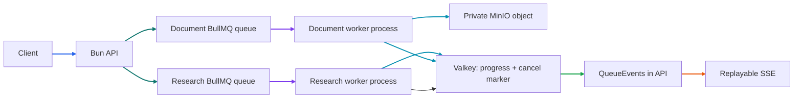

# Phase 3 Tutorial: Background Execution

## 1. Phase Overview

Phase 3 adds two independently managed Bun worker processes that consume the Phase 2 BullMQ queues. The API still accepts and validates requests quickly; workers perform the longer-running work and publish progress through the existing QueueEvents → Valkey Streams → SSE path.

Research execution is intentionally synthetic. The worker demonstrates planning, evidence-review, and synthesis stages without calling an LLM or web-search provider. Document ingestion reads the uploaded MinIO object, verifies its size, calculates a digest, and records that it is ready for Phase 4 extraction. No PDF text extraction, embeddings, or production research claims are added in this phase.

Active cancellation is cooperative. The API returns `202` and `cancellationRequested: true` while the task remains `processing`. A worker observes the Valkey cancellation marker, aborts its active job, and only then does the API record the terminal `cancelled` state and publish `task.cancelled`.

## 2. Learning Objectives

After this phase, you should be able to:

- Explain how an independently deployed BullMQ Worker consumes jobs from a queue.
- Separate API, research-worker, and document-worker process lifecycles.
- Use worker concurrency, lock renewal, stalled-job detection, and retries safely.
- Build an execution context that carries an execution ID, progress reporter, timeout, and abort signal.
- Implement cooperative cancellation across separate API and worker processes using Valkey.
- Distinguish retryable processor failures from non-retryable timeout/cancellation failures.
- Gracefully drain active jobs on SIGINT/SIGTERM and recover stalled jobs after interruption.
- Keep real LLM/search integration deferred to Phase 5 and document extraction to Phase 4.

## 3. Prerequisites

You need Bun 1.4.3 or compatible later, Docker with Compose, and the Phase 2 Valkey/MinIO services. From the repository root:

```sh
cp .env.example .env
bun install
```

The `.env.example` worker settings are:

```dotenv
RESEARCH_WORKER_CONCURRENCY=4
DOCUMENT_WORKER_CONCURRENCY=2
DOCUMENT_WORKER_TIMEOUT_SECONDS=300
WORKER_LOCK_DURATION_MS=30000
WORKER_STALLED_INTERVAL_MS=30000
WORKER_CANCEL_POLL_INTERVAL_MS=100
WORKER_SHUTDOWN_TIMEOUT_MS=30000
SIMULATED_STAGE_DELAY_MS=150
```

The central config validates ranges and applies these local defaults. In production, use environment-managed values and keep `.env` untracked. Worker code does not call `getLlmConfig()` in Phase 3; that accessor remains for the Phase 5 model integration.

## 4. Architecture Explanation

Each process consumes exactly one queue. Research jobs use the research queue and return the existing synthetic result schema. Document jobs use the document-ingestion queue and contain only an opaque MinIO object key, never the uploaded bytes. The API stays the producer and status/event reader.



The API runs on the host and uses `redis://localhost:6380` and `http://localhost:9000`. Compose workers use service DNS (`redis://valkey:6379` and `http://minio:9000`). The MinIO credentials and named `minio-data` volume remain the Phase 2 values.

## 5. Step-by-Step Implementation

### 5.1 Configure worker processes

`packages/config/src/index.js` exports `getWorkerConfig()`. It validates research/document concurrency, document timeout, Redis lock/stalled intervals, cancellation polling, graceful-shutdown warning threshold, and simulated stage delay. This keeps defaults in one place and prevents invalid concurrency/time values from being silently accepted.

`apps/workers/src/worker-runtime.js` constructs a BullMQ `Worker` for one queue, waits for readiness, and creates a separate Valkey client for cancellation checks. It logs queue/job/execution IDs and safe error codes only; it never logs research questions, file contents, credentials, or raw exception messages.

The runtime handles SIGINT/SIGTERM with `Worker.close()`. BullMQ stops taking new jobs and waits for active processors before the runtime closes its Valkey clients and optional MinIO client. The configured shutdown threshold emits a warning; it does not falsely mark active work complete. Compose uses a six-minute stop grace period so normal five-minute job budgets can finish.

### 5.2 Run the research workflow

`apps/workers/src/research-worker.js` launches a Worker for the `research` queue. The executor runs three simulated stages:

1. **Planning** — validates that execution is still active and publishes initial progress.
2. **Evidence review** — publishes a synthetic progress stage.
3. **Synthesis** — returns the Phase 1-compatible result with `synthetic: true`.

Every progress frame contains a per-attempt UUID `executionId`, stage, percent, and safe message. QueueEvents validates and forwards the frame into the existing bounded Valkey event stream, so clients continue to use the same `/events` endpoint.

The executor does not call an LLM, MCP server, web search, or database. This keeps Phase 3 focused on the worker lifecycle; Phase 5 will replace the synthetic executor with real model/search integrations.

### 5.3 Run document ingestion

`apps/workers/src/document-ingestion-worker.js` starts a separate Worker for the `document-ingestion` queue and initializes the S3-compatible client from central MinIO config. The worker reads `job.data.objectKey`, checks the bytes against the queued size, calculates a SHA-256 digest, and returns an ingestion receipt with `extractedText: false`.

The worker does not copy file bytes into Valkey or BullMQ. It passes the BullMQ signal to the S3 client and reports object-read, metadata-check, and ingestion-ready stages. Actual extraction/chunking belongs to Phase 4.

### 5.4 Enforce timeouts, cancellation, and retries

Research tasks use the request's validated `maxDurationSeconds`; document jobs use `DOCUMENT_WORKER_TIMEOUT_SECONDS`. On timeout, the runtime asks BullMQ to abort the active job and throws `UnrecoverableError("TASK_TIMED_OUT")`, so a deterministic timeout is not retried three times. Ordinary transient processor errors remain retryable under Phase 2's exponential backoff.

For active research cancellation, the API writes `evidencegraph:task-cancellation:<taskId>` in Valkey and publishes `task.cancellation_requested`. The task remains `processing`; the cancellation endpoint returns `202` with `cancellationRequested: true`. Each worker polls active task markers and calls BullMQ's `Worker.cancelJob()`, which aborts the processor signal. The execution context checks that signal and marker between stages. The worker throws `UnrecoverableError("TASK_CANCELLED")`; QueueEvents then changes the task to `cancelled` and removes the marker.

Waiting/delayed tasks still use Phase 2's immediate removal behavior. If a running task reaches completion just as a cancellation request arrives, the final worker state is authoritative; cancellation is cooperative rather than a promise to undo completed work.

### 5.5 Recover from interruption

Worker options apply validated `lockDuration`, `stalledInterval`, and a bounded `maxStalledCount`. BullMQ renews the lock while the worker is alive. If a process is forcibly interrupted, its lock expires; a different worker can move the stalled job back to the wait queue and execute it again. Because retries can duplicate an attempt, execution IDs are per attempt and future side effects must remain idempotent.

`docker-compose.yml` defines `research-worker` and `document-worker` separately. Each can restart independently without moving job processing into the API container. The existing Dockerfile already copies both workspace trees and installs the workspace lockfile.

Start the API plus infrastructure on the host:

```sh
docker compose up -d valkey minio
bun run dev:api
```

Start independent worker containers in another terminal:

```sh
docker compose up -d research-worker document-worker
docker compose ps
docker compose logs -f research-worker document-worker
```

For local watch mode instead:

```sh
bun run dev:workers:research
bun run dev:workers:documents
```

Run only one mode at a time for each queue; duplicate worker instances are supported but consume concurrency and should be intentional.

## 6. Code Walkthrough

| File                                               | Responsibility                                                                                              |
| -------------------------------------------------- | ----------------------------------------------------------------------------------------------------------- |
| `apps/workers/src/worker-runtime.js`               | Creates one BullMQ Worker, cancellation polling, timeout, safe logs, and graceful shutdown.                 |
| `apps/workers/src/execution-context.js`            | Exposes execution ID, progress, abort signal, cooperative checks, and simulated stage delay.                |
| `apps/workers/src/research-worker.js`              | Independently launches the research queue consumer.                                                         |
| `apps/workers/src/document-ingestion-worker.js`    | Independently launches the document queue consumer with MinIO.                                              |
| `apps/workers/src/executors/research.js`           | Three-stage deterministic synthetic research pipeline.                                                      |
| `apps/workers/src/executors/document-ingestion.js` | Reads/validates the MinIO object and returns a digest receipt.                                              |
| `packages/queue/src/store.js`                      | Records cancellation requests, returns HTTP-facing task state, and maps worker failures to terminal status. |
| `packages/queue/src/contracts.js`                  | Validates execution IDs, stages, cancellation-requested events, and progress payloads.                      |
| `packages/config/src/index.js`                     | Validates concurrency, timeout, stall, cancellation-poll, and shutdown settings.                            |
| `docker-compose.yml`                               | Starts research and document workers as separate services.                                                  |
| `apps/workers/src/integration.test.js`             | Tests real Valkey/MinIO job execution, cancellation, timeout, graceful drain, and recovery.                 |

## 7. Testing and Verification

Run default tests and checks from the repository root:

```sh
bun install --frozen-lockfile
bun test
bun run lint
bun run format:check
bun --cwd apps/web build
docker compose config --quiet
```

`bun test` visibly skips service integration tests by default. With Valkey and MinIO healthy, run both suites:

```sh
bun run test:phase2:integration
bun run test:phase3:integration
```

The Phase 3 suite verifies research result/progress/SSE, document byte retrieval from MinIO, an active cancellation request acknowledged by a worker, active-job graceful shutdown, a non-retryable timeout, and a forced worker close followed by stalled-job recovery. It uses unique test IDs and removes generated task metadata, event streams, jobs, and objects afterward.

To test containerized workers end to end, run the API on the host and start both Compose worker services. Submit a research request and document upload; verify their status changes to `completed`, inspect the SSE stream for `executionId`/stages, then delete the document.

## 8. Common Issues

- **Jobs remain queued:** Confirm `docker compose ps` shows both worker services running and ready; the Phase 2 queue has no consumer by itself.
- **Worker cannot connect to Valkey:** Host processes use `localhost:6380`; Compose workers must use `valkey:6379` and the same password.
- **Document jobs fail to read objects:** Host workers use `localhost:9000`; Compose workers must use `minio:9000`. Confirm MinIO health and bucket credentials.
- **Cancellation request remains processing:** `202` acknowledges the request only. The task becomes `cancelled` after the worker sees the marker and aborts at a checkpoint; inspect worker logs by job ID/execution ID.
- **A task is failed with `TASK_EXECUTION_TIMED_OUT`:** Increase the task's `maxDurationSeconds` within its allowed limit or reduce simulated/execution stage work. Timeouts are intentionally non-retryable.
- **A job restarts after a worker stop:** Graceful stop drains active jobs. A forced crash loses the lock; BullMQ requeues the stalled job after lock/stalled detection. Design future side effects to be idempotent.
- **LLM configuration is missing:** No worker in Phase 3 reads `LLM_*`; real LLM configuration is introduced with Phase 5. Do not add model keys to progress logs or image files.
- **Two workers consume one queue in local watch mode and Compose:** Stop one execution mode unless deliberately scaling; both will process jobs and share the configured concurrency budget.

## 9. Interview Preparation

### Why keep workers separate from the API?

API requests should validate and enqueue quickly. Separate workers isolate CPU/network work, allow independent concurrency/scaling, and keep web availability independent from research/document processing. The cost is broker dependency, deployment coordination, and idempotency/recovery design.

### How does BullMQ recover a worker crash?

A worker holds and renews a lock on its active job. If the process disappears, the lock expires; the stalled-job checker moves the job back to the waiting state for another worker. Recovery is at-least-once, so external side effects must be idempotent.

### Why does active cancellation return `202` rather than `cancelled` immediately?

The API only records a request. A worker must observe the Valkey marker, abort its active signal, and exit. Until QueueEvents reports that acknowledgement, the task is still processing. This avoids claiming that an active side effect was stopped before it actually was.

### How do timeouts differ from transient errors?

A configured execution budget aborts the job and uses `UnrecoverableError("TASK_TIMED_OUT")`; retrying the same deterministic over-budget work is not useful. Transient errors remain ordinary exceptions and use Phase 2's bounded backoff retries.

### How do you trace a task across retries?

The stable task/job ID identifies the logical request. Each processor attempt receives a new `executionId`; logs and progress events include both IDs plus stage and safe error codes. This distinguishes a retry from the prior execution without logging prompt or document content.

### How do you shut workers down without losing active work?

On SIGINT/SIGTERM the worker stops claiming new jobs and awaits `Worker.close()`, which waits for current processors. Compose's stop grace period allows the validated task timeout to expire. If the process is forcibly killed, BullMQ lock/stalled recovery handles the job instead.

### Why are the research results synthetic?

Phase 3 proves queue execution, progress, cancellation, timeouts, and recovery. Real LLM/search integration is a separate Phase 5 concern, and keeping it deferred prevents fake infrastructure code from being mistaken for production research.

### How would you explain this phase in an interview?

“I added independent Bun consumers for research and document-ingestion queues. Each job runs with a validated concurrency/timeout budget, emits execution-ID-tagged progress, and reads documents from private MinIO object keys. Active cancellation is a Valkey request acknowledged by the worker, while BullMQ lock/stall recovery handles forced interruptions. The current executors are synthetic by design; real LLM/search and extraction arrive in later phases.”

## 10. Phase Summary

Phase 3 adds independently deployable research/document workers, deterministic multi-stage execution, execution IDs and progress, cooperative active cancellation, task/document timeouts, graceful SIGTERM draining, BullMQ stalled-job recovery, Compose services, and real-service integration tests. The API remains the producer and status/SSE surface; worker processes own execution.

**Phase 4 dependencies:** Add PostgreSQL metadata persistence and document extraction/chunking. **Phase 5 dependencies:** Replace synthetic research stages with configured LLM and search integrations. Do not treat Phase 3's synthetic result as verified research.
