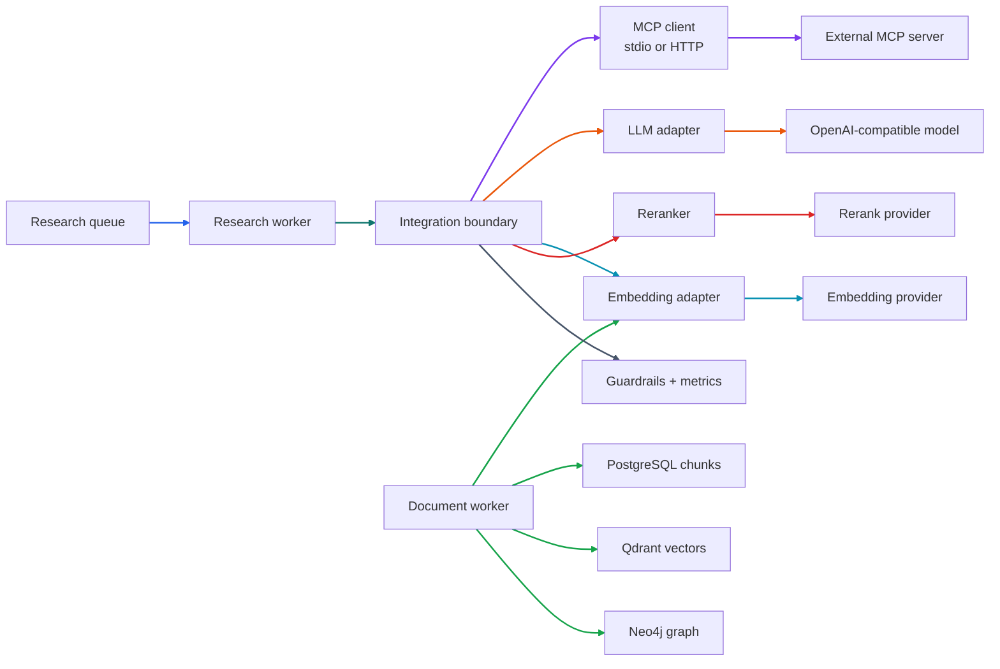
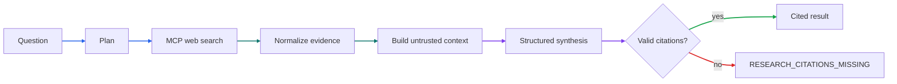

# Phase 5 Tutorial: External Service Integrations

## 1. Phase Overview

Phases 1–4 built a durable, asynchronous research platform: a Bun API, BullMQ queues, independent workers, PostgreSQL metadata, MinIO object storage, Qdrant vector infrastructure, and Neo4j graph persistence. Research execution was still synthetic, and no document was embedded.

Phase 5 connects the outside world:

- **Web search through MCP**, not a hand-built search engine.
- **A skills-backed adapter** for in-process search or retrieval capabilities that expose a compatible contract.
- **An OpenAI-compatible LangChain model adapter** driven entirely by `getLlmConfig()`.
- **Embedding generation** connected to the Qdrant ingestion path.
- **Reranking** with a deterministic lexical fallback.
- **LLM knowledge extraction** that writes validated entities, claims, and relationships into Neo4j.
- **Guardrails** for untrusted retrieved content, URL validation, tool-argument bounds, and secret redaction.
- **Observability** for tokens, latency, retries, failures, and approximate cost, with optional LangSmith tracing.

The boundary stays honest. If no MCP server is configured, web search fails with the classified `WEB_SEARCH_UNAVAILABLE` error instead of returning fabricated results. If no LLM is configured, production fails at startup or at the integration boundary. Development and tests can keep running the deterministic synthetic path until providers are supplied.

No live web-search provider was specified for this project. The automated tests therefore use local MCP fixture servers over **real stdio** and **real Streamable HTTP**, plus mock model and embedding clients. No live search result or model output is claimed.

## 2. Learning Objectives

After this phase, you should be able to:

- Configure LLM, embedding, reranking, MCP, and tracing settings centrally with Zod.
- Explain the difference between stdio and Streamable HTTP MCP transports.
- Build a provider-neutral MCP client and register web search only through that adapter.
- Normalize heterogeneous search results into one evidence schema with provenance.
- Validate tool arguments and treat every retrieved result as untrusted data.
- Enforce timeouts, rate limits, retries, and token/cost budgets at integration boundaries.
- Generate structured LLM output validated by Zod.
- Batch embeddings, validate dimensions, and write real vectors into Qdrant.
- Rerank candidates with a provider and fall back deterministically when it is unavailable.
- Extract entities, claims, and relationships and persist them into Neo4j.
- Keep provider failures classified and free of secrets.
- Run the worker's real integration path without introducing LangGraph yet.

## 3. Prerequisites

You need Bun 1.4.3 or compatible later, Docker with Compose, and the Phase 2–4 infrastructure running.

```sh
cp .env.example .env
bun install
docker compose up -d
bun run db:migrate
```

To use a real provider, fill in the relevant values in `.env`. Never commit them.

```dotenv
LLM_BASE_URL=https://api.example.com/v1
LLM_MODEL_NAME=replace-with-your-model
LLM_API_KEY=replace-with-your-api-key

# Opt in to real integrations outside production. Production always enables
# this path and fails closed when required configuration is missing.
AI_INTEGRATIONS_ENABLED=true
```

Optional providers:

```dotenv
# EMBEDDING_BASE_URL=https://api.example.com/v1
# EMBEDDING_MODEL_NAME=replace-with-your-embedding-model
# EMBEDDING_API_KEY=replace-with-your-embedding-key
EMBEDDING_DIMENSIONS=1536
EMBEDDING_BATCH_SIZE=32

# RERANK_ENDPOINT=https://api.example.com/v1/rerank
# RERANK_MODEL_NAME=replace-with-your-rerank-model
# RERANK_API_KEY=replace-with-your-rerank-key

# MCP_SEARCH_TRANSPORT=stdio
# MCP_SEARCH_COMMAND=your-mcp-server
# MCP_SEARCH_ARGS=["--stdio"]
# MCP_SEARCH_URL=https://mcp.example.com/mcp
# MCP_SEARCH_TOKEN=replace-with-your-mcp-token
MCP_SEARCH_TOOL=web_search
MCP_SEARCH_TIMEOUT_MS=15000
MCP_SEARCH_RATE_LIMIT_PER_MINUTE=30
```

If embeddings are enabled, `EMBEDDING_DIMENSIONS` must match the Qdrant collection size. If reranking is not configured, retrieval still works through the lexical fallback. If MCP is not configured, live research fails with `WEB_SEARCH_UNAVAILABLE`; it does not invent sources.

## 4. Architecture Explanation

The worker owns orchestration. Integrations sit behind adapters, and every adapter validates input and output.



### Why MCP instead of a search client?

MCP is a transport and tool protocol, not a search provider. The platform does not embed provider-specific request shapes in the agent. Any MCP server exposing a search tool can be plugged in through configuration. The same adapter shape works for a local stdio server and a remote Streamable HTTP server.

### Why a separate skills adapter?

Some capabilities are supplied as in-process skills rather than remote MCP servers. The skills adapter gives them the same contract: a validated input schema, a bounded execution time, normalized evidence output, and the same provenance and trust markers. Both paths feed the same downstream synthesis prompt.

### Why keep the synthetic path?

Development, unit tests, and the Phase 2–4 integration suites should not require paid provider credentials. The synthetic path remains available outside production when `AI_INTEGRATIONS_ENABLED` is not `true`. Production always takes the real path, so a missing provider fails visibly instead of silently returning mock output.

### Research execution flow



## 5. Step-by-Step Implementation

### 5.1 Extend central configuration

`packages/config/src/index.js` gains accessors for every external dependency:

- `getLlmConfig()` keeps the required `LLM_BASE_URL`, `LLM_MODEL_NAME`, and `LLM_API_KEY`, and adds temperature, output-token, timeout, retry, and cost settings.
- `getIntegrationConfig()` enables the real path in production or when `AI_INTEGRATIONS_ENABLED=true`.
- `getEmbeddingConfig()` returns `null` when no embedding model is named, and otherwise falls back to the LLM base URL and key.
- `getRerankConfig()` returns `null` when the endpoint or model is absent.
- `getMcpSearchConfig()` returns `null` when no transport is selected, and validates transport-specific fields.
- `getObservabilityConfig()` requires a LangSmith key when tracing is enabled.

Two details prevent configuration bugs:

1. Empty optional values are treated as unset. An `.env` line like `EMBEDDING_MODEL_NAME=` does not become an invalid empty string.
2. Error messages name variables, never values. A missing key error says `LLM_API_KEY`, not the secret.

### 5.2 Build the provider-neutral MCP client

`packages/ai/src/mcp-client.js` wraps the official `@modelcontextprotocol/sdk` client.

```js
export function createMcpTransport(config) {
  if (config.transport === "stdio") {
    return new StdioClientTransport({
      command: config.command,
      args: config.args,
      stderr: "ignore",
    });
  }
  return new StreamableHTTPClientTransport(new URL(config.url), {
    ...(config.token
      ? {
          requestInit: { headers: { authorization: `Bearer ${config.token}` } },
        }
      : {}),
  });
}
```

`createMcpClient()` connects lazily, exposes `listTools()` and `callTool()`, and closes cleanly. The rest of the application never imports a provider SDK directly.

The stdio transport spawns a child process. The HTTP transport uses the Streamable HTTP specification, including session handling. Both are exercised by the test suite against real fixture servers.

### 5.3 Normalize web-search results

`packages/ai/src/web-search.js` wraps a configured MCP tool.

It passes configurable field names:

```js
{
  [config.queryField]: query,
  [config.limitField]: limit,
}
```

That keeps the adapter neutral across tools that use `query` or `q`, `limit` or `max_results`.

Results are extracted from either `structuredContent` or a text content block, then normalized by `normalizeWebResults()`:

- Accepts arrays, `{ results }`, and `{ data }` shapes.
- Accepts `url`/`link`/`href`, `title`/`name`/`headline`, and `snippet`/`description`/`content`/`text`.
- Rejects non-HTTP URLs and URLs containing credentials.
- Deduplicates by URL.
- Caps the result count.
- Attaches a stable `sourceId`, `trust: "untrusted"`, and provenance (`provider`, `tool`, `retrievedAt`).

Every search call also enforces:

- A per-process sliding-window rate limit.
- A request timeout passed to the MCP SDK.
- Classification of 401/403, 429, 5xx, and timeout failures.

### 5.4 Add the skills-backed adapter

`packages/ai/src/skills.js` registers skills with a name, kind, Zod input schema, execution function, result cap, and timeout.

```js
const adapter = createSkillsToolAdapter({ skills: [searchSkill] });
const sources = await adapter.invoke("fixture-search", {
  query: "urban heat",
  limit: 5,
});
```

The adapter validates arguments, rejects reserved object keys, bounds JSON size and depth, enforces a timeout, and normalizes results through the same evidence schema. Duplicate registrations fail fast.

### 5.5 Add the LLM adapter

`packages/ai/src/llm.js` creates a `ChatOpenAI` instance from `getLlmConfig()` only:

```js
new ChatOpenAI({
  apiKey: config.apiKey,
  model: config.modelName,
  temperature: config.temperature,
  maxTokens: config.maxOutputTokens,
  timeout: config.timeoutMs,
  maxRetries: 0,
  configuration: { baseURL: config.baseUrl },
});
```

`maxRetries` is zero because the adapter owns retries. That keeps retry counts and metrics consistent and lets the caller's abort signal stop the whole loop.

`createStructuredGenerator().generate()`:

1. Defines a Zod schema, such as `researchSynthesisSchema`.
2. Calls `withStructuredOutput(schema, { name, includeRaw: true })`.
3. Sends a system prompt and a user prompt.
4. Retries transient failures with exponential backoff.
5. Re-validates the parsed output with the same Zod schema.
6. Records duration, tokens, approximate cost, and failure code.

The raw response is included so token usage can be read from `usage_metadata`. The model never sees a raw provider error: the adapter classifies it.

### 5.6 Embed documents and index vectors

`packages/ai/src/embeddings.js` implements an OpenAI-compatible embedding client with `fetch`.

- `embedBatch()` validates input, sends `{ model, input }`, and checks the response count.
- Every vector must match `EMBEDDING_DIMENSIONS`.
- Every value must be finite.
- `embedDocuments()` splits input into `EMBEDDING_BATCH_SIZE` batches and retries transient failures.
- `embedQuery()` embeds a single string.

The document worker calls it after chunk persistence:

```js
const vectors = await embeddings.embedDocuments(
  chunks.map((chunk) => chunk.content),
  { signal: context.signal },
);
await persistence.vectorRepository.upsertPoints(points);
```

Each Qdrant point uses the stable chunk ID, the dense vector, and a tenant-scoped payload. This is the first phase where real document vectors enter the collection. Without an embedding client, the Phase 4 behavior is preserved: chunks and graph metadata are saved, but no fake vectors are created.

### 5.7 Rerank with a deterministic fallback

`packages/ai/src/rerank.js` defines one interface:

```js
await reranker.rerank({ query, documents, limit });
```

With a provider configured, it calls the configured `/rerank` endpoint and validates that every returned index is in range and every score is finite.

Without a provider, or when the provider fails, it returns a lexical score based on token overlap. The result includes `fallback: true` and, on failure, the classified `errorCode`. Retrieval therefore degrades predictably instead of failing the whole research task.

### 5.8 Extract and persist knowledge

`packages/ai/src/knowledge.js` asks the model for a strict structure:

```js
{
  entities: [{ name, kind, aliases }],
  claims: [{ text, confidence, entityNames, chunkId? }],
  relationships: [{ from, to, type, confidence }]
}
```

Normalization then:

- Trims and normalizes names.
- Deduplicates entities by normalized name and merges aliases.
- Drops relationships whose endpoints are not in the extracted entity set.
- Deduplicates claims by normalized text.
- Keeps `chunkId` only when it matches a chunk that actually belongs to the document.
- Generates a stable UUID for each entity and claim.

`persistKnowledge()` writes:

- Entities through `graphRepository.upsertEntities()`.
- Claims through `graphRepository.upsertClaims()`, linking them to the document with `SUPPORTS`.
- Relationships through `graphRepository.upsertRelationships()`, creating `RELATED_TO` edges with a typed `kind`.

The Neo4j repository now also deletes claims when a document is deleted, so the graph does not accumulate orphaned evidence.

### 5.9 Apply guardrails

`packages/ai/src/guardrails.js` implements the safety rules that matter at this boundary:

- `sanitizeUntrustedText()` normalizes text, strips control characters, and caps length.
- `asUntrustedData()` wraps retrieved content in explicit delimiters and marks it as data, not instructions.
- `parseSafeUrl()` accepts only HTTP(S) URLs without embedded credentials.
- `assertSafeToolArguments()` rejects `__proto__`, `constructor`, and `prototype` keys, bounds nesting depth, and caps JSON size.
- `redactSecrets()` removes known secrets from diagnostic strings.

The system prompt states that untrusted blocks are data and that citations may only use supplied `sourceId` values. The adapter also filters any citation the model invents.

### 5.10 Record observability

`packages/ai/src/observability.js` provides:

- `createMetrics()` with call count, failures, retries, tokens, latency, and approximate cost.
- `withRetry()` with exponential backoff and abort support.
- `createTracer()` with an optional LangSmith `traceable` wrapper.

Metrics contain operation names, durations, token counts, and error codes. They never contain prompts, retrieved content, API keys, or provider response bodies.

LangSmith tracing is disabled by default. When `LANGSMITH_TRACING=true`, `LANGSMITH_API_KEY` is required. The tests keep tracing off and make no network calls to LangSmith.

### 5.11 Integrate with the research worker

`packages/ai/src/research.js` composes the adapters:

```js
const integrations = createResearchIntegrations({ env });
```

It returns `null` outside production unless `AI_INTEGRATIONS_ENABLED=true`. In production it always builds the real path, so missing LLM configuration fails visibly.

`runResearch()` performs one bounded pass:

1. Report `planning`.
2. Call MCP search with the question and `maxSources`.
3. Report `evidence-review`.
4. Build an untrusted evidence prompt.
5. Ask the model for a structured summary, claims, and citations.
6. Filter citations to retrieved source IDs.
7. Fail with `RESEARCH_CITATIONS_MISSING` if no valid citation remains.
8. Report `synthesis` and return `synthetic: false`.

The research executors map non-retryable `IntegrationError`s to BullMQ `UnrecoverableError`s. A missing search server is a configuration failure, not a transient error, so the job does not burn retry attempts.

The shared research result schema changed from `synthetic: true` to `synthetic: boolean`, because a real run must also produce a valid persisted result.

## 6. Code Walkthrough

### `packages/config/src/index.js`

The single source of truth for provider configuration. Read the accessor for a dependency before using it; it already validates and redacts.

### `packages/ai/src/mcp-client.js`

Transport selection and the official SDK client. Use `createMcpClient()` rather than instantiating transports elsewhere.

### `packages/ai/src/web-search.js`

The standardized search interface. This is where rate limits, timeouts, payload extraction, and result normalization live.

### `packages/ai/src/skills.js`

The in-process counterpart to MCP tools. It shares the evidence contract and guardrails.

### `packages/ai/src/llm.js`

Model construction, structured generation, retry policy, and token/cost metrics.

### `packages/ai/src/embeddings.js`

Batching, dimension validation, and retry behavior for embeddings.

### `packages/ai/src/rerank.js`

Provider scoring plus the deterministic fallback.

### `packages/ai/src/knowledge.js`

Prompt construction, strict extraction schema, normalization, stable identifiers, and graph persistence.

### `packages/ai/src/research.js`

Composition and the research pipeline. This is the integration boundary the worker calls.

### `apps/workers/src/executors/research.js`

Chooses the real path or the synthetic path and maps classified failures to BullMQ semantics.

### `apps/workers/src/executors/document-ingestion.js`

Adds the optional embedding and Qdrant indexing stage after chunk persistence.

### `packages/persistence/src/graph.js`

Adds claim and relationship persistence, reads, and deletion cleanup.

## 7. Testing and Verification

### Unit and contract tests

```sh
bun test
```

At the end of Phase 5 the default suite reports **112 passing tests** with the four real-service integration suites skipped.

Phase 5 adds coverage for:

- Configuration defaults, production behavior, empty optional values, and missing secrets.
- MCP stdio transport against a real fixture server process.
- MCP Streamable HTTP transport against a real fixture server.
- Web-search payload extraction, normalization, rate limiting, and error classification.
- Skills registration, validation, invocation, provenance, and failure normalization.
- Structured LLM output, retries, non-retryable authorization failures, and malformed output.
- Embedding batching, dimension checks, and authorization classification.
- Reranking order, provider failure fallback, and lexical scoring.
- Knowledge normalization, extraction, stable IDs, and graph persistence.
- Research composition, citation filtering, missing citations, and unavailable search.
- Worker executors: real research path, non-retryable mapping, and vector upsert after chunking.

### Real infrastructure suites

```sh
bun run test:phase2:integration
bun run test:phase3:integration
bun run test:phase4:integration
```

These confirm that the Phase 5 changes did not break queue delivery, worker execution, PostgreSQL persistence, MinIO, Qdrant, or Neo4j. The Phase 3 suite explicitly sets `AI_INTEGRATIONS_ENABLED=false` so a developer's local provider settings cannot make CI-style tests call the network.

### Live-provider verification

Live verification requires real values in `.env`. Do not commit them. With `AI_INTEGRATIONS_ENABLED=true` and an MCP server configured:

```sh
bun run dev:api
bun run dev:workers:research
```

Submit a research task and watch SSE progress. Without MCP configured, the task fails with `WEB_SEARCH_UNAVAILABLE`; that is the expected honest behavior, not a bug.

With embeddings configured, upload a document:

```sh
curl -F "file=@sample.txt;type=text/plain" http://localhost:3000/api/v1/documents
```

The document worker extracts text, chunks it, generates vectors, and writes them to Qdrant.

### Quality checks

```sh
bun run lint
bun run format:check
bun --cwd apps/web build
```

## 8. Common Issues

### `WEB_SEARCH_UNAVAILABLE`

No MCP transport is configured. Set `MCP_SEARCH_TRANSPORT` and either `MCP_SEARCH_COMMAND` (stdio) or `MCP_SEARCH_URL` (HTTP). Production does not substitute mock results.

### `Missing LLM configuration: LLM_BASE_URL, LLM_MODEL_NAME, LLM_API_KEY`

The real integration path is enabled but the model is not configured. Add the values to `.env`. Outside production, unset `AI_INTEGRATIONS_ENABLED` to use the synthetic path.

### MCP stdio server never responds

Check that `MCP_SEARCH_COMMAND` is on `PATH`, that `MCP_SEARCH_ARGS` is valid JSON, and that the server writes protocol messages to stdout. Diagnostic output belongs on stderr; the client ignores stderr to keep the protocol stream clean.

### Streamable HTTP returns 404 or 401

Confirm `MCP_SEARCH_URL` is the MCP endpoint, not the server root. If the server requires authentication, set `MCP_SEARCH_TOKEN`; the client sends it as `Authorization: Bearer ...`.

### `EMBEDDING_DIMENSION_MISMATCH` or `DOCUMENT_EMBEDDING_DIMENSION_MISMATCH`

The provider returned a vector length different from `EMBEDDING_DIMENSIONS`. The Qdrant collection was created with that size. Change the configuration and recreate the collection, or use a matching model.

### `RESEARCH_CITATIONS_MISSING`

The model produced a summary without citing any retrieved source. The adapter discards invented citation IDs. Improve the prompt or model, or accept the failure; an uncited report is not treated as success.

### Reranking always reports `fallback: true`

No rerank endpoint is configured, or the provider failed. The lexical fallback is intentional and deterministic. Check the `errorCode` in the fallback result for the classified cause.

### LangSmith warnings or missing traces

Set both `LANGSMITH_TRACING=true` and `LANGSMITH_API_KEY`. Tracing is off by default and does not affect local tests.

### Secrets appear in logs

They should not. The adapters classify errors into stable codes and human-readable messages. If you add a new provider, never log raw request headers, response bodies, or configuration objects.

## 9. Interview Preparation

### Why use MCP instead of integrating a search API directly?

MCP separates capability from provider. The agent calls a standardized tool; the transport and server are configuration. That avoids hard-coding one vendor's request and response format into the orchestration layer, and it lets the same worker use local or remote search servers.

### What is the difference between stdio and Streamable HTTP?

Stdio runs the server as a child process and exchanges JSON-RPC over stdin/stdout. It is simple and local. Streamable HTTP communicates with a remote server over HTTP with session handling and optional streaming. Both are supported by the same client abstraction.

### How do you stop retrieved text from becoming instructions?

Retrieved text is never inserted as a system message. It is sanitized, length-bounded, and wrapped in an explicit `<untrusted-data>` block. The system prompt says the block is data and must not be followed. The model's citations are validated against known source IDs, so injected URLs or IDs are discarded.

### How do you handle tool arguments safely?

The adapter validates them with Zod, rejects reserved prototype keys, bounds nesting depth, and caps serialized size. These checks block prototype pollution and oversized payloads before a provider sees the request.

### Why retry some failures and not others?

Timeouts, 429s, and 5xx responses are transient and retryable. 400/401/403/404/422 responses indicate a bad request or bad credentials and will not improve on retry. BullMQ gets a non-retryable error for the latter, so the job does not waste attempts.

### How are tokens and costs tracked?

The LLM adapter requests raw output alongside the parsed object, reads `usage_metadata.total_tokens`, and multiplies by the configured blended rate. Metrics record calls, failures, retries, tokens, latency, and approximate cost. They never record prompts or secrets.

### Why is there a synthetic path?

It keeps development and tests deterministic and credential-free. It is disabled in production, where the real path is mandatory. That avoids the common failure mode of shipping mock output to users.

### Why defer LangGraph to Phase 6?

Phase 5 proves each external capability independently: search, synthesis, embeddings, reranking, and knowledge extraction. Phase 6 then composes those proven adapters into a stateful graph with planning, verification, checkpoints, and human approval. Building the graph first would make provider failures harder to isolate.

### How would you explain this phase in an interview?

"Phase 5 turned the durable platform into one that can actually talk to the outside world. We added a provider-neutral MCP client for both stdio and Streamable HTTP, a skills adapter, an OpenAI-compatible LangChain model adapter with structured Zod output and retry budgets, embedding generation wired into Qdrant indexing, reranking with a deterministic fallback, and LLM knowledge extraction into Neo4j. Every external result is validated and treated as untrusted, provider failures are classified without leaking secrets, and production never falls back to mocks."

## 10. Phase Summary

Phase 5 delivers:

- Central configuration for LLM, embeddings, reranking, MCP, and LangSmith.
- A provider-neutral MCP client supporting stdio and Streamable HTTP.
- A standardized web-search tool with rate limits, timeouts, and evidence normalization.
- A skills-backed tool adapter with the same validation and provenance contract.
- An OpenAI-compatible structured LLM adapter with bounded retries and token/cost metrics.
- Batched embedding generation with dimension validation.
- Real document vector indexing in Qdrant when embeddings are configured.
- Reranking with a deterministic lexical fallback.
- LLM knowledge extraction with validated Neo4j claims and relationships.
- Guardrails for untrusted content, URLs, tool arguments, and secrets.
- Optional LangSmith tracing and local metrics.
- 112 passing unit tests, including real local MCP transport tests.

Deferred to Phase 6:

- LangGraph state, checkpoints, and thread persistence.
- Planning, research, verification, and report nodes.
- Hybrid dense + sparse retrieval and reciprocal rank fusion.
- Human-in-the-loop approval and resume.
- Citation evaluation and end-to-end research quality fixtures.

Deferred to Phase 7:

- Better Auth login UI and workspace navigation.
- The full Next.js research experience, source collections, graph exploration, and report export.
