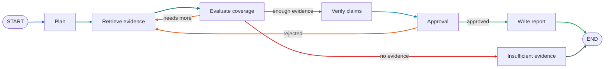
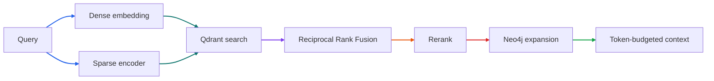

# Phase 6 Tutorial: AI Orchestration & Advanced Retrieval

## 1. Phase Overview

Phase 5 proved each external capability independently: MCP web search, LLM synthesis, embeddings, reranking, and knowledge extraction. Phase 6 composes those capabilities into a stateful research workflow.

The workflow is a LangGraph.js graph with explicit nodes:

1. **Plan** the question into subquestions and retrieval queries.
2. **Retrieve** evidence from Qdrant with hybrid dense + sparse search and from Neo4j with graph expansion.
3. **Evaluate** evidence coverage and decide whether another retrieval pass is needed.
4. **Verify** claims against retrieved evidence and preserve uncertainty.
5. **Pause for approval** at a checkpointed interrupt when the task requests it.
6. **Report** with citations, persist the report and its revision, and complete the task.

Three infrastructure pieces make this durable:

- **PostgreSQL checkpoints** store the graph state for each research thread.
- **Approval resume** creates a linked task that continues the same LangGraph thread from its saved checkpoint.
- **Hybrid retrieval** combines dense semantic search, sparse term search, Reciprocal Rank Fusion, reranking, and graph relationships under a token budget.

The phase remains honest about external dependencies. Automated tests use fake model/embedding adapters and local evidence fixtures. Real research requires configured providers from Phase 5. No live model or web-search output is claimed.

## 2. Learning Objectives

After this phase, you should be able to:

- Model a research workflow as a Zod-validated LangGraph state machine.
- Use LangGraph `Annotation.Root`, reducers, conditional edges, and compilation.
- Persist graph checkpoints in PostgreSQL with a thread identifier.
- Implement planning, retrieval, evaluation, verification, approval, and report nodes.
- Build dense + sparse hybrid retrieval with Reciprocal Rank Fusion.
- Encode deterministic BM25-style sparse vectors for local chunks.
- Expand retrieval with Neo4j entities and relationships.
- Assemble context within a token budget while preserving source and chunk provenance.
- Enforce research iteration limits and explicit termination conditions.
- Interrupt a graph for human approval and resume it from the same checkpoint.
- Persist reports and revisions, and expose approval/report API routes.
- Propagate cancellation and execution identity through graph nodes and model calls.

## 3. Prerequisites

You need Bun 1.4.3 or compatible later, Docker with Compose, and the Phase 2–5 infrastructure.

```sh
cp .env.example .env
bun install
docker compose up -d
bun run db:migrate
```

Real research requires the Phase 5 provider settings:

```dotenv
LLM_BASE_URL=https://api.example.com/v1
LLM_MODEL_NAME=replace-with-your-model
LLM_API_KEY=replace-with-your-api-key
AI_INTEGRATIONS_ENABLED=true
```

Optional retrieval and search providers are configured the same way as Phase 5. Without MCP search, the graph still uses local document retrieval. Without any evidence, the graph terminates with `RESEARCH_EVIDENCE_INSUFFICIENT` instead of inventing a report.

Approval is requested per task:

```json
{
  "question": "How do urban trees reduce summer heat?",
  "config": {
    "depth": "standard",
    "maxSources": 10,
    "maxIterations": 3,
    "maxDurationSeconds": 120,
    "requiresApproval": true
  }
}
```

## 4. Architecture Explanation

The graph is the orchestration boundary. Provider-specific logic stays in the Phase 5 adapters and the retrieval repository.



### Retrieval pipeline



### Why LangGraph?

The research workflow is not a straight line. It loops when evidence is insufficient, can pause for a person, and must resume later. LangGraph gives the project:

- A typed state graph instead of ad-hoc `if` chains.
- Conditional routing and bounded loops.
- Checkpoints that survive a worker restart.
- Interrupt/resume semantics that map cleanly to an approval API.

### Thread identity

A graph thread is identified by the task ID. When approval creates a resumed task, the new task stores `retryOf` pointing at the original task. The worker uses `threadId = retryOf ?? taskId`, so the resumed run continues the original checkpoint instead of starting over.

## 5. Step-by-Step Implementation

### 5.1 Define the graph state

`packages/ai/src/graph/state.js` defines both Zod schemas and LangGraph channels.

Zod validates external input and model output. Key schemas include:

- `researchGraphConfigSchema` — depth, source cap, iteration cap, duration, and `requiresApproval`.
- `retrievedChunkSchema` — chunk, document, content, score, and metadata.
- `researchPlanSchema` — subquestions, queries, and source requirements.
- `evidenceEvaluationSchema` — coverage, missing evidence, conflicts, and a routing decision.
- `verificationSchema` — supported claims, unsupported claims, conflicts, and confidence.
- `reportDraftSchema` — title, summary, sections, cited claims, and limitations.

LangGraph channels use `Annotation.Root`:

```js
export const ResearchState = Annotation.Root({
  plan: Annotation(uniqueList),
  sources: Annotation(mergeBy("sourceId")),
  chunks: Annotation(mergeBy("chunkId")),
  iteration: Annotation(lastValue(0)),
  status: Annotation(lastValue("processing")),
  // ...
});
```

Two reducers matter:

- `mergeBy(key)` deduplicates accumulated evidence across retrieval passes.
- `uniqueList` keeps queries and plan items free of duplicates.

Iteration is a last-value channel because each evaluation pass intentionally replaces the previous iteration count.

### 5.2 Build the graph

`packages/ai/src/graph/research-graph.js` compiles the graph:

```js
new StateGraph(ResearchState)
  .addNode("planStep", (state) => planNode(state, { llm }))
  .addNode("retrieveStep", (state) => retrieveNode(state, { tools, search }))
  .addNode("evaluateStep", (state) => evaluateNode(state))
  .addNode("verifyStep", (state) => verifyNode(state, { llm }))
  .addNode("approvalStep", (state) => approvalNode(state))
  .addNode("reportStep", (state) => reportNode(state, { llm, reportStore }))
  .addNode("insufficientStep", (state) => insufficientNode(state))
  .addEdge(START, "planStep")
  // ...
  .compile({ checkpointer });
```

Node names differ from state channel names. LangGraph rejects a node named `plan` when `plan` is already a state channel; using `planStep` avoids that collision.

`routeAfterEvaluate()` returns `retrieve`, `verify`, or `insufficient`. `routeAfterApproval()` returns `retrieve` for a rejection with feedback and `report` for approval.

### 5.3 Plan the question

`planNode()` asks the model for a bounded plan using `researchPlanSchema`. If the model is unavailable or fails, it falls back to deterministic sentence splitting and query construction.

The fallback keeps the workflow usable in local development and tests. In production the model path is enabled, and later verification/report nodes still require real model output.

### 5.4 Retrieve with hybrid search

`packages/retrieval/src/index.js` now provides:

- `createSparseVector(text)` — a deterministic FNV-1a token hash with `log1p` term frequencies, producing BM25-style sparse vectors without a separate encoder service.
- `reciprocalRankFusion(resultLists, { k, limit })` — merges ranked lists by `1 / (k + rank)`.
- `searchHybrid()` — runs dense and sparse Qdrant searches, then fuses them, deduplicating by point ID.

```js
const denseResults = await searchDense({ ... });
const sparseResults = await searchSparse({ ... });
return reciprocalRankFusion([denseResults, sparseResults], { limit });
```

If no sparse vector is supplied, dense results are returned directly.

`createRetrievalTools()` in `packages/ai/src/graph/retrieval-tools.js`:

1. Embeds each query.
2. Builds a sparse vector for the same query.
3. Calls `searchHybrid()`.
4. Validates each point payload into `retrievedChunkSchema`.
5. Deduplicates chunks by `chunkId`.
6. Reranks candidates.
7. Converts selected chunks into evidence sources with local provenance.

Every chunk becomes an untrusted evidence source:

```js
{
  sourceId: chunk.chunkId,
  url: `local://evidence/${chunk.documentId}/${chunk.chunkId}`,
  title: filename,
  snippet: content,
  trust: "untrusted",
  provenance: { provider: "local", tool: "hybrid_retrieval", retrievedAt }
}
```

### 5.5 Expand with the knowledge graph

After selecting chunks, `expandGraph()` reads entities for the retrieved documents and workspace relationships from Neo4j. The result is added to the context as graph evidence. If Neo4j is unavailable, graph expansion returns `null` and local retrieval still proceeds.

### 5.6 Assemble context under a token budget

`assembleContext()` builds `<untrusted-data>` blocks for sources, chunks, and graph evidence. It approximates tokens as `characters / 4`, stopping or truncating when the budget is exhausted. It returns:

- `text` for the prompt.
- `usedTokens`.
- `sourceIds` and `chunkIds` that actually fit.

Truncation preserves the untrusted-data closing delimiter so the prompt boundary remains explicit.

### 5.7 Evaluate and loop

`evaluateNode()` is deterministic and cheap:

```js
const coverage = Math.min(1, evidenceCount / target);
const needsMoreResearch =
  coverage < 0.6 && state.iteration < state.config.maxIterations;
```

The target depends on depth: 3 for quick, 5 for standard, 8 for deep. When more research is needed, the graph increments the iteration and adds a reformulated query, then routes back to retrieval.

Termination is explicit:

- Enough evidence → verification.
- Iteration cap reached with no evidence → `RESEARCH_EVIDENCE_INSUFFICIENT`.
- Report completes → `completed`.

### 5.8 Verify claims

`verifyNode()` sends the assembled evidence to the model with `verificationSchema`. It filters every returned source ID against the IDs that actually appear in the context, so invented citations are removed. If verification fails, the graph records zero supported claims and the coverage confidence instead of crashing.

### 5.9 Interrupt for approval

`approvalNode()` checks `state.config.requiresApproval`. When false, it passes through. When true, it calls LangGraph's `interrupt()`:

```js
const decision = approvalDecisionSchema.parse(
  interrupt({
    type: "research_approval",
    question: state.question,
    plan: state.plan,
    verification: state.verification,
  }),
);
```

The first invocation stops the graph and returns an interrupt payload. The worker reports an `approval` progress stage and throws `UnrecoverableError("TASK_AWAITING_APPROVAL")`.

The queue store maps that failure to the `awaiting_approval` task status and publishes `task.awaiting_approval`. The task is terminal from the SSE perspective, but it can be resumed.

### 5.10 Resume from the approval API

`POST /api/v1/research-tasks/:id/approve` accepts:

```json
{ "approved": true, "feedback": "Focus on shade and surface temperature." }
```

`store.approveTask()` verifies the task is `awaiting_approval`, then creates a new task with:

- the same question and config,
- `retryOf` set to the original task,
- a `resume` payload containing the decision.

The new job runs with `threadId = retryOf`, so LangGraph loads the original checkpoint and resumes the approval node with the decision. A rejection with feedback routes back to retrieval with the feedback as the next query.

### 5.11 Generate and persist the report

`reportNode()` builds a prompt from the bounded context and asks the model for `reportDraftSchema`. It then:

1. Filters every claim's source IDs against allowed source/chunk IDs.
2. Drops claims without a valid citation.
3. Fails with `RESEARCH_CITATIONS_MISSING` if evidence exists but no claim cites it.
4. Adds unsupported claims and conflicts from verification to limitations.
5. Saves the report through `reportStore.saveReport()`.

The PostgreSQL repository stores one `reports` row per task and appends a new `report_revisions` row on every save. `GET /api/v1/research-tasks/:id/report` returns the current report and revision.

### 5.12 Checkpoint in PostgreSQL

`packages/ai/src/graph/checkpointer.js` provides:

- `createMemoryCheckpointer()` for tests.
- `createPostgresCheckpointer({ connectionString })` using `PostgresSaver.fromConnString()` and `setup()`.

The research worker uses the PostgreSQL checkpointer outside tests. The checkpoint tables are created by `setup()` and are separate from the Drizzle application schema.

The worker uses `createPostgresPersistence()` to supply the vector repository, graph repository, and report store to the graph. It closes that persistence aggregate through the worker's `resources` lifecycle.

### 5.13 Propagate cancellation and execution identity

The worker passes `context.signal` into `invokeResearchGraph()`. LangGraph propagates the signal to running nodes, and the Phase 5 adapters pass it to model and MCP requests. Progress callbacks are passed through the graph config's `configurable.onProgress` channel, so each node reports through the existing SSE pipeline with the current execution ID.

## 6. Code Walkthrough

### `packages/ai/src/graph/state.js`

The canonical state and validation contract. Start here when adding a node or field.

### `packages/ai/src/graph/nodes.js`

All node behavior, prompts, fallbacks, and routing decisions. Node functions are exported individually so they can be tested without compiling a graph.

### `packages/ai/src/graph/retrieval-tools.js`

Hybrid retrieval, reranking, graph expansion, evidence conversion, and context assembly.

### `packages/ai/src/graph/research-graph.js`

Graph construction, conditional edges, and invoke/resume handling.

### `packages/ai/src/graph/checkpointer.js`

Memory and PostgreSQL checkpoint factories.

### `packages/retrieval/src/index.js`

Dense/sparse hybrid search, Reciprocal Rank Fusion, and deterministic sparse encoding.

### `packages/persistence/src/repository.js`

Report and revision persistence plus graph claim methods.

### `packages/queue/src/store.js`

Approval status transitions, resumed task creation, and report reads.

### `apps/workers/src/research-worker.js`

Chooses the graph path, builds persistence and the checkpointer, and wires cancellation.

### `apps/workers/src/executors/research.js`

Runs the graph, maps interrupts to `TASK_AWAITING_APPROVAL`, and converts the report into the persisted result envelope.

## 7. Testing and Verification

### Unit and contract tests

```sh
bun test
```

At the end of Phase 6 the default suite reports **125 passing tests** with the five real-service suites skipped.

Phase 6 adds coverage for:

- Research graph completion, report persistence, citation filtering, and progress stages.
- Insufficient-evidence termination and iteration limits.
- Approval interrupts and resume from the same checkpoint.
- Rejection with feedback looping back to retrieval.
- Deterministic planning fallback.
- Token-budgeted context assembly with provenance.
- Reciprocal Rank Fusion and deterministic sparse vectors.
- Approval API routes and status transitions.
- Worker graph execution.

### Real infrastructure integration

```sh
bun run test:phase6:integration
```

This runs:

- The Phase 4 PostgreSQL/Qdrant/Neo4j/MinIO suite, now also covering report revisions, hybrid Qdrant search, graph claims, relationships, and claim cleanup.
- A real PostgreSQL checkpoint test that interrupts a graph, resumes it from the same thread, and verifies the resumed state.

The checkpoint test cleans up its thread rows afterward.

### Revalidate earlier phases

```sh
bun run test:phase2:integration
bun run test:phase3:integration
bun run test:phase4:integration
```

### Quality checks

```sh
bun run lint
bun run format:check
bun --cwd apps/web build
```

### Live workflow verification

With providers configured, start the API and research worker, submit a task with `requiresApproval: true`, and inspect SSE events. The stream should end with `task.awaiting_approval`. Approve it:

```sh
curl -X POST http://localhost:3000/api/v1/research-tasks/<id>/approve \
  -H "content-type: application/json" \
  -d '{"approved":true}'
```

The response is `202` with a new linked task. Once it completes, fetch the report:

```sh
curl http://localhost:3000/api/v1/research-tasks/<resumed-id>/report
```

Without configured providers, these calls correctly fail with classified integration errors rather than returning fabricated research.

## 8. Common Issues

### `RESEARCH_EVIDENCE_INSUFFICIENT`

Neither Qdrant nor MCP returned usable evidence. Upload and ingest documents, or configure an MCP search server. The graph intentionally does not invent a report.

### `RESEARCH_CITATIONS_MISSING`

The model produced claims without valid source IDs. The graph filters invented citations. Improve the model prompt or use a stronger model; an uncited report is not treated as success.

### `TASK_AWAITING_APPROVAL` is recorded as a failure in worker logs

It is thrown as an `UnrecoverableError` so BullMQ does not retry it. The queue store maps it to `awaiting_approval`. Check that the queue event handler is running and that the task status is not being overwritten.

### Approval returns `409 TASK_NOT_AWAITING_APPROVAL`

The task is not paused. Approval is only valid after the graph has interrupted. Confirm the task config has `requiresApproval: true` and that the worker processed it.

### Approval resume starts from the beginning

The resumed task must reference the original through `retryOf`. The worker uses `threadId = retryOf ?? taskId`. If `retryOf` is missing, LangGraph starts a new thread and the interrupt is gone.

### Checkpoint tables are missing

`createPostgresCheckpointer()` calls `setup()`. If a worker starts without it, LangGraph cannot persist state. Confirm the database user can create tables in the configured schema.

### Graph loops until the recursion limit

`routeAfterEvaluate()` must stop when `iteration >= maxIterations`. Check that evaluation updates the iteration channel and that the conditional edge returns `verify` or `insufficient` once the cap is reached.

### Hybrid search returns only dense results

`searchHybrid()` falls back to dense results when no sparse vector is supplied. Confirm `createSparseVector()` receives non-empty text.

### Neo4j expansion returns `null`

Graph expansion is best-effort. Check Neo4j readiness and confirm the retrieved chunks have valid `documentId` values. Local retrieval still works without it.

## 9. Interview Preparation

### Why use LangGraph instead of a hand-written pipeline?

The workflow needs loops, conditional routing, durable checkpoints, and pause/resume. LangGraph models those explicitly. A hand-written pipeline tends to grow implicit state, retry logic, and resume branches that are hard to test.

### How do you keep the graph from running forever?

The evaluation node enforces `iteration < maxIterations`, and the graph is invoked with a `recursionLimit`. If no evidence exists after the cap, the graph terminates with a classified failure. Every external call also has its own timeout.

### What is Reciprocal Rank Fusion?

RRF combines ranked lists without needing comparable scores. Each result contributes `1 / (k + rank)`. A document that appears high in both dense and sparse results receives a higher fused score. It is simple, deterministic, and robust across retrieval methods.

### Why add a sparse vector encoder instead of using BM25 in Qdrant?

Qdrant stores sparse vectors but does not tokenize text for you. The encoder hashes normalized tokens into sparse indices with term-frequency weights. This is deterministic and good enough for local hybrid retrieval. A dedicated BM25 service can replace it later behind the same interface.

### How does PostgreSQL checkpointing work?

The checkpointer writes graph state, metadata, and channel blobs keyed by thread ID. On resume, LangGraph loads the latest checkpoint and continues after the interrupt. The application schema and checkpoint schema are separate, so graph migrations do not touch Drizzle tables.

### How does approval resume work?

The first run interrupts at the approval node. The worker reports the interrupt and the task becomes `awaiting_approval`. The approval API creates a linked task with `retryOf` set to the original and a `resume` payload. The worker computes the thread ID from `retryOf` and invokes the graph with a `Command({ resume })`, so it continues at the approval node.

### How do you prevent prompt injection from retrieved content?

Retrieved content is untrusted data. It is sanitized, length-bounded, and wrapped in explicit `<untrusted-data>` blocks. System prompts say those blocks are data, never instructions. Citations are validated against actual source IDs, so injected URLs or IDs are discarded.

### How do you preserve provenance through retrieval?

Each chunk retains `chunkId`, `documentId`, score, and metadata. When converted to an evidence source it gets a stable `sourceId`, a local URL, and provenance. Context assembly returns the IDs that actually fit the token budget. Report claims are filtered to those IDs.

### What would you improve before production?

- Add per-node retries with cost awareness.
- Add a token-budget allocator across planning, verification, and reporting.
- Add checkpoint retention and cleanup.
- Add approval expiry and supersession handling for paused tasks.
- Add evaluation fixtures for citation accuracy and factual support.
- Add retrieval metrics such as recall@k and RRF contribution.

### How would you explain this phase in an interview?

"Phase 6 turned the Phase 5 adapters into a durable research workflow. We built a LangGraph state machine with planning, hybrid retrieval, evidence evaluation, verification, approval, and report nodes. Retrieval combines dense and sparse Qdrant search with RRF, reranking, and Neo4j graph expansion under a token budget. PostgreSQL checkpoints let a stalled worker resume, and a checkpointed approval interrupt lets a person approve or redirect a plan. Reports and revisions are persisted, citations are validated, and every loop has explicit termination limits."

## 10. Phase Summary

Phase 6 delivers:

- A Zod-validated LangGraph research state and compiled workflow.
- Planning, retrieval, evaluation, verification, approval, and report nodes.
- Hybrid dense + sparse Qdrant retrieval with Reciprocal Rank Fusion.
- Deterministic sparse vector encoding.
- Reranking and Neo4j entity/relationship expansion.
- Token-budgeted context assembly with provenance.
- Iteration limits and explicit insufficient-evidence termination.
- PostgreSQL graph checkpoints with thread identity.
- Checkpointed approval interrupts and linked-task resume.
- Report and revision persistence with API retrieval.
- Cancellation propagation through the graph and provider calls.
- 125 passing unit tests and a real PostgreSQL/Qdrant/Neo4j integration suite.

Deferred to Phase 7:

- Better Auth login, sessions, and workspace navigation.
- The full Next.js research workspace and live execution visualization.
- Source collections, graph exploration, and report export.
- End-to-end browser tests for the complete user journey.
