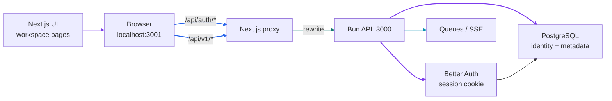
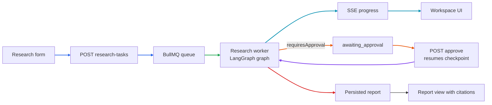

# Phase 7 Tutorial: User Experience

## 1. Phase Overview

Phase 7 turns the backend platform into a usable product. Phases 1–6 delivered a Bun API, BullMQ workers, PostgreSQL/Qdrant/Neo4j/MinIO persistence, provider-neutral external integrations, and a checkpointed LangGraph research workflow — all reachable only through HTTP clients and tests.

This phase adds:

- **Better Auth with PostgreSQL**: email/password sign-up, sign-in, sessions, and sign-out backed by the Better Auth-compatible `user`/`session`/`account`/`verification` tables created in Phase 4.
- **A server-derived identity contract**: the API resolves `userId` from the session cookie, never from caller-supplied headers, and validates any requested workspace against `workspace_members` membership.
- **A Next.js App Router workspace**: sign-in page, research submission form, task history, live SSE progress, approval controls, document upload, and report viewing with clickable citations.
- **A single-origin architecture**: the Next dev server proxies `/api/auth/*` and `/api/v1/*` to the Bun API, so the browser never crosses origins, no CORS is needed, and cookies work naturally.
- **End-to-end verification**: an HTTP smoke covering rendering, proxied authentication, workspace-scoped task creation, unauthenticated rejection, and approval guards.

Production behavior stays fail-closed: without `AUTH_SECRET` and `AUTH_URL`, the API refuses to start; protected routes in production without auth return `503 AUTH_NOT_CONFIGURED`.

## 2. Learning Objectives

After this phase, you should be able to:

- Configure Better Auth with a Drizzle adapter over an existing schema.
- Explain why identity must come from a server-side session, not a header.
- Validate workspace membership so scope headers cannot cross tenants.
- Design a same-origin proxy to avoid CORS and cookie partitioning problems.
- Build a responsive Next.js workspace with accessible forms and status states.
- Stream task progress from an SSE endpoint using `fetch` instead of `EventSource` when headers are required.
- Render a persisted report with citation chips that navigate to their sources.
- Verify the stack end to end without fabricating provider results.

## 3. Prerequisites

You need Bun 1.4.3 or compatible later, Docker with Compose (OrbStack), and the Phase 2–6 infrastructure.

```sh
cp .env.example .env
bun install
docker compose up -d
bun run db:migrate
```

Phase 7 adds these environment variables (placeholders are safe locally):

```dotenv
AUTH_SECRET=local-development-auth-secret-minimum-32-chars
AUTH_URL=http://localhost:3000
AUTH_TRUSTED_ORIGINS=http://localhost:3001
AUTH_ENABLE_SIGN_UP=true
API_ORIGIN=http://localhost:3000
```

In production you must set a real 32+ character `AUTH_SECRET` and a public `AUTH_URL`; both are validated by `getAuthConfig()` and the API fails closed without them. Never commit real secrets.

Start the stack in two terminals:

```sh
NODE_ENV=development bun run dev:api     # Bun API on port 3000
API_ORIGIN=http://localhost:3000 bun run dev   # Next.js on port 3001
```

Then open `http://localhost:3001`.

## 4. Architecture Explanation

The browser talks to exactly one origin. Next.js forwards API and auth traffic to the Bun API.



### Why a proxy instead of CORS?

`localhost:3001` and `localhost:3000` are different origins. Session cookies plus cross-origin fetches would require credentialed CORS, explicit `credentials: "include"`, allowed origins, and careful cookie attributes. Rewriting both API prefixes through Next keeps every request same-origin: the cookie is set and read under one origin, `EventSource`-style streaming still works, and the trusted-origin surface is small.

### How identity is derived

1. Better Auth issues a session cookie on sign-up or sign-in.
2. The API calls `auth.api.getSession({ headers })` — the session is the only identity source.
3. `authenticate()` returns `{ userId, workspaceId }`.
4. If the client sends `x-workspace-id`, it must appear in `workspace_members` for that user, otherwise the request fails with `403 WORKSPACE_FORBIDDEN`.
5. Without the header, the first membership is used; a brand-new user falls back to a personal workspace (`workspaceId = userId`), which `ensureOwner()` materializes on first write.

Caller headers never establish _identity_ — only _scope_, and scope is validated.

### Task lifecycle through the UI



## 5. Step-by-Step Implementation

### 5.1 Central auth configuration

`packages/config/src/index.js` adds `getAuthConfig()`:

```js
export function getAuthConfig(env = process.env) {
  if (env.NODE_ENV === "production") {
    const missing = ["AUTH_SECRET", "AUTH_URL"].filter((key) => !env[key]);
    if (missing.length > 0) {
      throw new Error(
        `Missing authentication configuration: ${missing.join(", ")}.`,
      );
    }
  }
  // ...Zod validation, trusted-origin parsing, dev fallback
}
```

Production fails closed on both values. Development gets a deterministic fallback secret so the local UI works out of the box, but the schema still enforces the 32-character minimum. `AUTH_TRUSTED_ORIGINS` is a comma-separated list parsed into an array. Error messages name variables, never values.

### 5.2 The auth package

`packages/auth/src/index.js` builds the Better Auth instance:

```js
const instance = betterAuth({
  appName: "EvidenceGraph",
  secret: authConfig.secret,
  baseURL: authConfig.url,
  trustedOrigins: authConfig.trustedOrigins,
  database: drizzleAdapter(database, {
    provider: "pg",
    schema: {
      user: schema.users,
      session: schema.sessions,
      account: schema.accounts,
      verification: schema.verifications,
    },
  }),
  emailAndPassword: { enabled: authConfig.enableSignUp, autoSignIn: true },
});
```

It reuses the Phase 4 tables directly — no second auth schema. The package exposes three operations:

- `authenticate(request)` — resolves the session and the validated workspace.
- `listWorkspaces(userId)` — memberships with ISO timestamps (Drizzle returns `Date`, the API schema expects strings).
- `close()` — drains the client it owns. The API passes its existing Drizzle `db`, so one connection pool serves both auth and application data.

### 5.3 Auth routes in the API

`createApiHandler()` now accepts `auth`. Public auth routes are handled before any identity check:

```js
if (url.pathname.startsWith("/api/auth/")) {
  if (!auth) throw new ApiError(503, "AUTH_NOT_CONFIGURED", "...");
  return auth.instance.handler(request);
}
```

A `GET /api/v1/workspaces` route lists memberships for the authenticated identity. The server entry wires everything:

```js
const auth = createAuthInstance({
  env: process.env,
  db: persistence.database.db,
});
const server = Bun.serve({
  fetch: createApiHandler({ store, auth, authenticate: auth.authenticate }),
});
```

### 5.4 Next.js proxy configuration

`apps/web/next.config.mjs` rewrites both API prefixes:

```js
const backend = process.env.API_ORIGIN ?? "http://localhost:3000";
async rewrites() {
  return [
    { source: "/api/auth/:path*", destination: `${backend}/api/auth/:path*` },
    { source: "/api/v1/:path*", destination: `${backend}/api/v1/:path*` },
  ];
}
```

The web app runs on port 3001 (`next dev -p 3001`) so the API keeps port 3000.

### 5.5 The client library

`apps/web/lib/api.js` is the typed data layer:

- Every request sends `credentials: "include"` and the active `x-workspace-id`.
- Error envelopes become `ApiClientError` with `status`, `code`, and `message`.
- `authApi` wraps session, sign-in, sign-up, and sign-out.
- `uploadDocument()` posts `FormData` with the same headers.

`apps/web/lib/events.js` reads SSE with `fetch` and a stream reader instead of `EventSource`, because `EventSource` cannot attach headers or credentials options. It parses `id:`/`data:` frames and exposes an abortable promise so React cleanup cancels the stream.

### 5.6 Workspace pages

Four route groups make up the UI:

- `/` — landing page; shows Sign in or Open workspace depending on session.
- `/sign-in` — combined sign-in/sign-up form with inline error display.
- `/workspace` — the research workspace (session-guarded client component).

The workspace page composes five components:

| Component         | Responsibility                                                |
| ----------------- | ------------------------------------------------------------- |
| `WorkspaceHeader` | Session email, workspace selector, sign-out                   |
| `ResearchForm`    | Question + depth/sources/iterations/timeout/approval controls |
| `TaskList`        | History with status chips and selection                       |
| `TaskDetail`      | Live SSE progress, cancel/retry/approve/reject, report button |
| `DocumentPanel`   | Upload, status list, deletion                                 |
| `ReportView`      | Report body, claim citations, limitations, source list        |

State handling follows explicit loading/error/empty rules:

- The page shows "Loading workspace…" until the session resolves, then redirects to `/sign-in` if there is none.
- The task list polls every 3 seconds only while a task is `queued` or `processing`.
- `TaskDetail` opens an SSE stream for non-terminal tasks and closes it in effect cleanup.
- Approval controls appear only for `awaiting_approval`; cancel only for active tasks; retry only for failures; "View report" only for completed tasks.

Accessibility: forms use real labels, errors use `role="alert"`, the progress bar exposes `role="progressbar"` with values, and transitions are suppressed under `prefers-reduced-motion` with `motion-reduce:transition-none`.

### 5.7 Citations in the report

Phase 6 was extended to persist `sources` alongside the report body. `ReportView`:

1. Loads `GET /research-tasks/:id/report`.
2. Builds a `sourceId → source` map from `body.sources`.
3. Renders each claim's `sourceIds` as citation chips.
4. Clicking a chip scrolls to and focuses the matching source card.
5. External `https` URLs become `target="_blank" rel="noopener noreferrer"` links; local chunk URLs render as text.

Every claim in the stored report was already filtered to evidence that actually exists, so every chip resolves.

### 5.8 Tests

- **Config**: auth fallback, trusted-origin parsing, production fail-closed for `AUTH_SECRET`/`AUTH_URL`.
- **API**: auth-route delegation, `503 AUTH_NOT_CONFIGURED` without auth, workspace listing, production protection.
- **Web client**: envelope decoding, typed error mapping, upload headers, session/auth failure handling.
- **Real PostgreSQL (`test:phase7:integration`)**: sign-up → cookie → session → identity resolution, `403 WORKSPACE_FORBIDDEN` for a foreign workspace, and rejection of wrong credentials.

## 6. Code Walkthrough

### `packages/auth/src/index.js`

Better Auth construction, session resolution, workspace membership validation, and lifecycle.

### `packages/config/src/index.js` (`getAuthConfig`)

Validates and normalizes all authentication settings with fail-closed production rules.

### `apps/api/src/app.js`

Auth route delegation, the workspaces endpoint, and identity extraction for every protected route.

### `apps/api/src/index.js`

Composes persistence, auth, the store, and the Bun server; closes everything on shutdown.

### `apps/web/next.config.mjs`

Same-origin proxy for API and auth traffic.

### `apps/web/lib/api.js` and `apps/web/lib/events.js`

The browser's data layer: envelope decoding, typed errors, workspace headers, and SSE over fetch.

### `apps/web/app/workspace/page.js`

Session guard, polling, selection state, and panel composition.

### `apps/web/components/*.js`

The individual panels described above.

### `apps/web/scripts/phase7-e2e-smoke.js`

The runnable HTTP end-to-end check.

## 7. Testing and Verification

### Unit tests

```sh
bun test
```

At the end of Phase 7 the default suite reports **135 passing tests** with 8 real-service tests skipped.

### Real authentication against PostgreSQL

```sh
bun run test:phase7:integration
```

### All earlier real-service suites

```sh
bun run test:phase2:integration
bun run test:phase3:integration
bun run test:phase6:integration   # includes Phase 4 storage checks
```

### Quality checks

```sh
bun run lint
bun run format:check
bun run build --cwd apps/web
```

### End-to-end smoke

```sh
NODE_ENV=development bun run dev:api
API_ORIGIN=http://localhost:3000 bun run dev    # in apps/web
bun apps/web/scripts/phase7-e2e-smoke.js
```

The script verifies: landing page render, `/sign-in` and `/workspace` responses, proxied sign-up with session cookie, proxied session read, authenticated task creation (`202`), workspace-scoped listing, `401` without a session, workspace listing, and approval rejected while the task is not paused.

### Manual walkthrough

Open `http://localhost:3001`, create an account, submit a question with "Require plan approval" enabled (workers running via `bun run dev:workers:research`), watch the progress stages, approve the plan when it pauses, then open the report and click a citation chip.

Without configured providers the task will fail with a classified integration error — that is expected and honest; the UI surfaces the failure state and offers Retry.

## 8. Common Issues

### `503 AUTH_NOT_CONFIGURED`

Production started without `AUTH_SECRET`/`AUTH_URL`, or the API was created without an `auth` instance. Set the variables in the environment.

### Sign-in works but API calls return `401`

The session cookie is not reaching the API. Confirm requests go through the Next proxy (`/api/...` on port 3001) rather than calling port 3000 directly from the browser, and that `API_ORIGIN` matches the API.

### `403 WORKSPACE_FORBIDDEN`

The selected workspace is not in `workspace_members` for the session user. Re-select a workspace in the header; the selector is populated from the membership list.

### Cookies rejected as cross-site

`AUTH_TRUSTED_ORIGINS` must include the web origin (`http://localhost:3001`). If you change the web port or deploy on another domain, update it.

### `PORT` conflict between API and Next

The API uses 3000 and Next uses 3001. Both are fixed in scripts; don't run a second server on 3000.

### Workspace list shows `INTERNAL_ERROR`

Historically caused by returning Drizzle `Date` objects where the response schema expects ISO strings. `listWorkspaces()` now serializes explicitly; if you add new endpoints, convert timestamps the same way.

### Progress stream stays empty

`TaskDetail` only opens the SSE stream for non-terminal tasks, and it depends on an active workspace header. Select the task again after switching workspaces; the stream reconnects per selection.

### Better Auth rate-limit warnings in tests

The client IP cannot be resolved for direct in-process handler calls. The warning is informational; forwarded headers (`x-forwarded-for`) are configured for real deployments.

## 9. Interview Preparation

### Why is identity never taken from a header?

A header is attacker-controlled. Identity must be derived from a server-validated session cookie. The only header we accept is a _scope_ selector, and it is validated against `workspace_members` before use, so it can narrow access but never widen it.

### How do you prevent cross-workspace data leaks?

Every repository query filters on `userId` and `workspaceId`, Qdrant searches carry a tenant filter, Neo4j operations require `workspaceId`, and the API validates any workspace selector against membership. Isolation is enforced at the API boundary and again at storage.

### Why proxy through Next instead of enabling CORS?

Same-origin requests simplify cookies, avoid credentialed CORS configuration, keep `EventSource`/fetch behavior uniform, and reduce the trusted-origin surface. The trade-off is one extra hop in development, which is negligible locally and replaceable by a reverse proxy in production.

### How does session state reach the client?

The client calls `/api/auth/get-session` through the proxy on mount and redirects to `/sign-in` when it returns no user. There is no client-side token storage — the browser only holds an HTTP-only cookie that the server validates.

### What happens on approval?

The worker's graph interrupts and throws a non-retryable error; the queue store maps it to `awaiting_approval`. The UI shows the approval panel. `POST /approve` creates a linked task (`retryOf`) whose job resumes the same LangGraph thread with a `Command({ resume })`, so plan, evidence, and verification state are preserved.

### How do you handle loading, empty, and error states?

Each panel declares them explicitly: skeleton text while loading, a dashed empty-state card when no items exist, and `role="alert"` messages for failures. Status chips reflect the canonical task lifecycle so the UI never invents a state the backend doesn't have.

### What would you improve before production?

- Real browser end-to-end tests (Playwright) for the full journey.
- Server-side session checks in Next for stricter redirect behavior.
- Optimistic UI updates with rollback.
- Workspace creation/management UI instead of implicit personal workspaces.
- Audit logging for report access and workspace switches.

### How would you explain this phase in an interview?

"Phase 7 made the platform usable end to end. Authentication is Better Auth on PostgreSQL with sessions resolved server-side, and workspace scope is validated against memberships so no header can widen access. The Next.js workspace proxies API and auth traffic to keep everything same-origin, which avoids CORS and cookie problems. The UI covers submission, live SSE progress, approval and resume, document upload, and report viewing with citations that navigate to their sources. We verified it with unit tests, a real PostgreSQL auth integration, and an HTTP end-to-end smoke."

## 10. Phase Summary

Phase 7 delivers:

- Central auth configuration with production fail-closed validation.
- Better Auth on PostgreSQL using the Phase 4 user/session/account/verification tables.
- Session-derived identity plus validated workspace scope selection.
- Public auth routes and a workspaces endpoint in the Bun API.
- Same-origin Next.js proxy for API and auth traffic.
- Sign-in/sign-up flow, session-guarded workspace, research form, history, live progress, approval controls, document management, and report viewing with clickable citations.
- Workspace, loading, empty, and error states with accessible markup.
- 135 passing unit tests, 3 real PostgreSQL auth integration tests, and a runnable HTTP end-to-end smoke.

Deferred / known limitations:

- Real browser end-to-end suites are documented but not committed; use `bun apps/web/scripts/phase7-e2e-smoke.js` for HTTP-level verification.
- Workspace creation UI and organization plugin features are future work; users get an implicit personal workspace.
- Markdown/PDF report export and graph-exploration UI remain future work behind the persisted report and graph data already in place.
